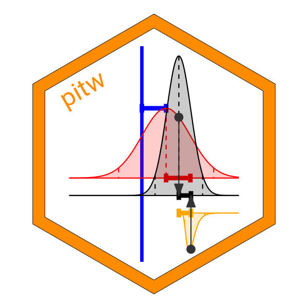

# PIT-Wasserstein: A Calibration Metric for Probabilistic Estimators  

  <!-- badges: start -->
[](https://github.com/ai4ci/ggoutbreak/actions/workflows/R-CMD-check.yaml)
[](https://ai4ci.r-universe.dev/pitw)
[](https://doi.org/10.5281/zenodo.24555797)
[](https://gtr.ukri.org/projects?ref=EP%2FY028392%2F1)
<!-- badges: end -->

A dispersion calibration metric for probabilistic estimators, disentangled from 
bias and sharpness. Originally published as Supplementary Appendix 2 of
**Challen & Danon (2025), "Instantaneous Reproduction Number Estimation From
Modelled Incidence"**; this repository is the extension into a standalone paper
titled "Diagnosing miscalibration with PIT-Wasserstein metrics".

The [R package documentation](https://ai4ci.github.io/pit-wasserstein/) has
resources on how to use the package and instructions to reproduce the figures
from the upcoming paper.

The [Lean proof library](proof/README.md) gives the asymptotic null laws for 
all three significance tests and instructions for importing them into another 
Lean project.

## Installation

`pitw` is hosted on the [AI4CI r-universe](https://ai4ci.r-universe.dev/).
Installation of releases from there is as follows:

``` r
options(repos = c(
  "ai4ci" = 'https://ai4ci.r-universe.dev/',
  CRAN = 'https://cloud.r-project.org'))

# Download and install pitw in R
install.packages("pitw")
```

You can install the development version of `pitw` from
[GitHub](https://github.com/ai4ci/pit-wasserstein) with:

``` r
# install.packages("devtools")
devtools::install_github("ai4ci/pit-wasserstein")
```

---

## Core concepts

The paper defines three metrics for assessing probabilistic estimators and 
differentiating between, bias, dispersion miscalibration, and skill-spread
decoupling.

### Baseline PIT-Wasserstein ($B_{pit}$)

$$B_{pit} = \frac{1}{n}\sum_{i=1}^n{|u_i - rank_i|}$$

Where $rank_i = (i-0.5)/n$ and $u_i$ are the PIT values.

- **Range:** [0, 0.5]. Zero = perfect calibration and zero bias.
- **Property:** Symmetric on log-calibration for a given bias.
- **Validated:** Dependent on bias, dispersion calibration and sharpness in simulation.

### Adjusted PIT-Wasserstein ($U^*_{pit}$)

$$U_{pit} = \frac{1}{n}\sum_{i=1}^n{|u_{i,adj} - rank_i|}$$

Where $rank_i = (i-0.5)/n$ and $u_{i,adj}$ are the bias-adjusted PIT values.

- **Range:** [0, 0.5]. Zero = perfect calibration.
- **Property:** Symmetric on log-calibration — conservative and overconfident
  estimators of equal magnitude score equally.
- **Validated:** Independent of bias and sharpness in simulation.

### Directed PIT-Wasserstein ($D^*_{pit}$)

$$D_{pit} = \frac{1}{n}\sum_{i=1}^n{(rank_i - u_{i,adj}) \times \operatorname{sgn}(0.5-rank_i)}$$

- **Range:** [-0.25, +0.25]
- **Direction:** Positive = overconfident (U-shaped PIT histogram); Negative =
  conservative (dome-shaped).

All three metrics have significance tests based on large-sample reference
distributions for independent PIT values. The adjusted tests use reference laws
derived for the Gaussian location model.

---

### Summary

The **adjusted PIT-Wasserstein ($U^*_{pit}$)** combines:

1. **Bias adjustment** before PIT uniformity assessment (no other metric does this)
2. **Wasserstein/L1 distance** rather than sup-norm (PCE) or binning (reliability diagrams)
3. **Signed direction** ($D^*_{pit}$) distinguishing overconfidence from over-conservatism
4. **Validation** showing it is independent of bias and sharpness

---

## Funding

The authors gratefully acknowledge the support of the UK Research and Innovation
AI programme of the Engineering and Physical Sciences Research Council [EPSRC
grant EP/Y028392/1](https://gtr.ukri.org/projects?ref=EP%2FY028392%2F1).

---
