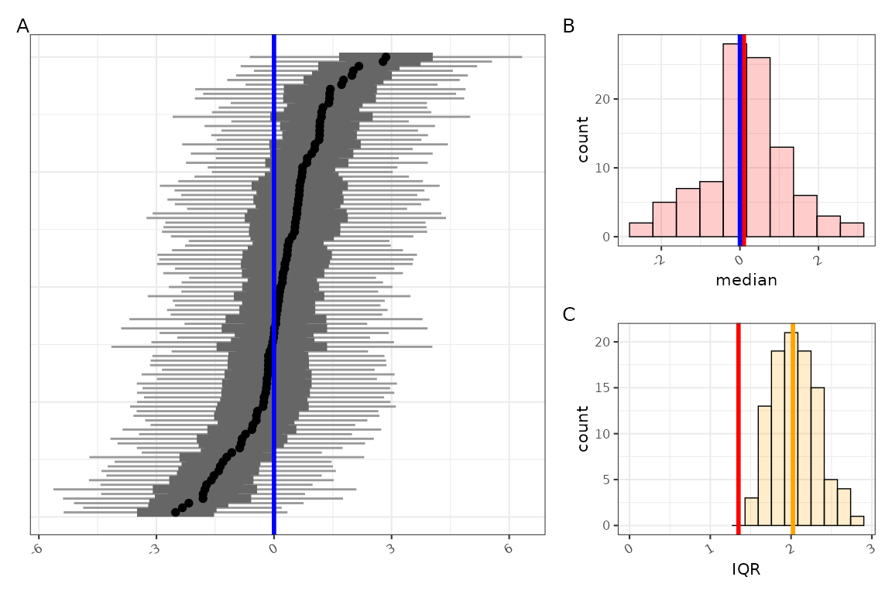
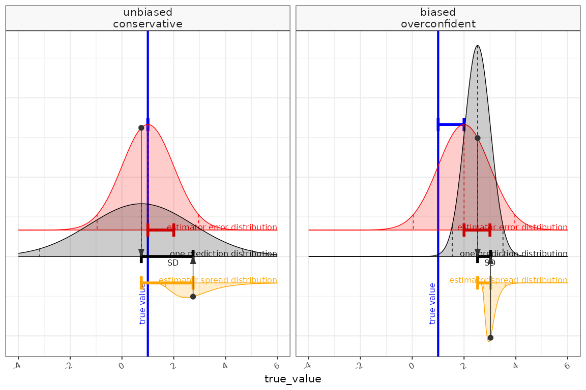
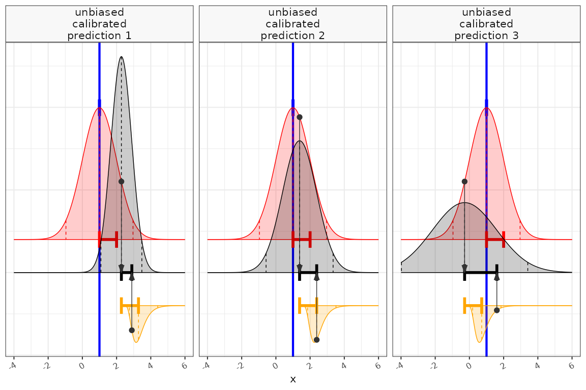
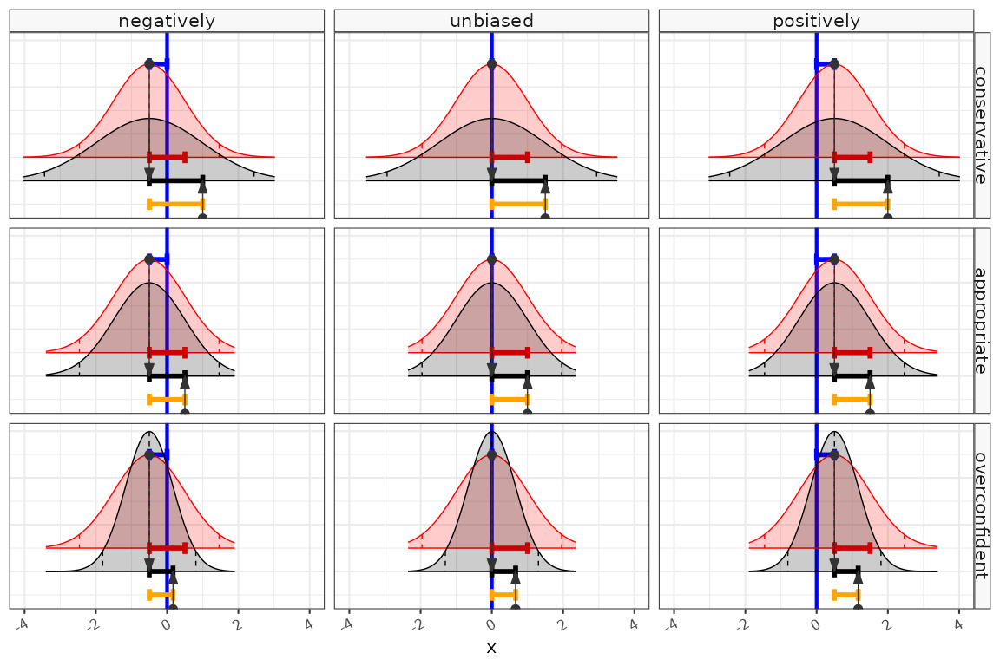
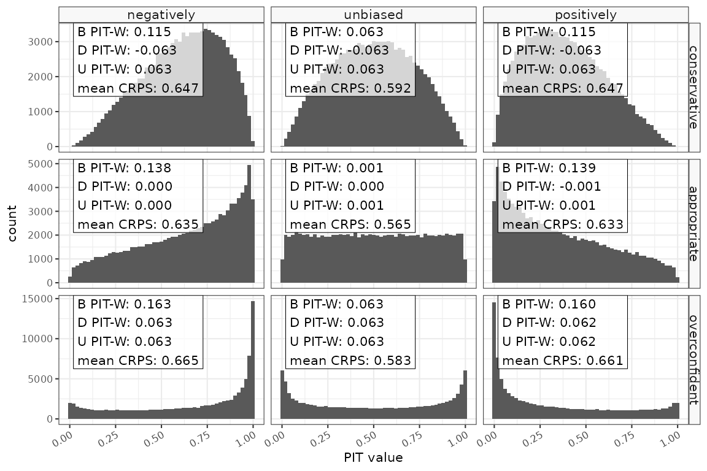

# Introduction to calibration and probability integral transforms

``` r

# library(pitw)
devtools::load_all()
#> ℹ Loading pitw
library(tidyverse)
#> ── Attaching core tidyverse packages ──────────────────────── tidyverse 2.0.0 ──
#> ✔ dplyr     1.2.1     ✔ readr     2.2.0
#> ✔ forcats   1.0.1     ✔ stringr   1.6.0
#> ✔ ggplot2   4.0.4     ✔ tibble    3.3.1
#> ✔ lubridate 1.9.5     ✔ tidyr     1.3.2
#> ✔ purrr     1.2.2     
#> ── Conflicts ────────────────────────────────────────── tidyverse_conflicts() ──
#> ✖ readr::edition_get()   masks testthat::edition_get()
#> ✖ dplyr::filter()        masks stats::filter()
#> ✖ dplyr::lag()           masks stats::lag()
#> ✖ readr::local_edition() masks testthat::local_edition()
#> ℹ Use the conflicted package (<http://conflicted.r-lib.org/>) to force all conflicts to become errors
.gg_pedantic()
#> Warning: The requested font(s): [Roboto], are not present on the system. Alternatives will be used.
#> This warning is displayed once per session.
fig_dir = here::here("vignettes", "main", "fig")
```

We compare 100 predictive distributions with the same reference value.
Their medians show how far the forecasts are centred from that value,
and their intervals show how much uncertainty the forecaster reports. We
then use probability integral transform (PIT) histograms to examine how
location bias and predictive spread affect the full distributions.

## An estimator and its predictions

The simulated estimator is slightly biased and reports intervals that
are too wide. We assess these tendencies across all 100 predictions
because even a well-calibrated interval can miss the reference value on
an individual occasion.

``` r


true_value = 0
estimator_bias_mean = 0.1
estimator_bias_sd = 1
estimator_bias_IQR = diff(qnorm(c(0.25,0.75), estimator_bias_mean, estimator_bias_sd))
calibration = 1.5
estimator_spread_mean = estimator_bias_sd*calibration 
estimator_spread_sd = 0.2
samples = 100

predictions = tibble(
  prediction_mean = true_value + rnorm(samples, estimator_bias_mean, estimator_bias_sd),
  sample = rank(prediction_mean,ties.method = "first"),
  prediction_sd = rlnorm2(samples, estimator_spread_mean, estimator_spread_sd),
  prediction.0.025 = qnorm(0.025, prediction_mean, prediction_sd),
  prediction.0.25 = qnorm(0.25, prediction_mean, prediction_sd),
  prediction.0.5 = qnorm(0.5, prediction_mean, prediction_sd),
  prediction.0.75 = qnorm(0.75, prediction_mean, prediction_sd),
  prediction.0.975 = qnorm(0.975, prediction_mean, prediction_sd),
  prediction_IQR = prediction.0.75-prediction.0.25,
)

fig1a = ggplot(data=predictions)+
  geom_segment(aes(y=sample, x=prediction.0.025, xend=prediction.0.975, yend = sample), linewidth = 0.5, colour="grey60")+
  geom_segment(aes(y=sample, x=prediction.0.25, xend=prediction.0.75, yend = sample), linewidth = 2, colour="grey40")+
  geom_point(aes(y=sample, x=prediction.0.5), size = 2)+
  geom_vline(xintercept = true_value, colour = "blue", linewidth = 1)+
  ggplot2::theme(
      axis.line.y = ggplot2::element_blank(),
      axis.ticks.y = ggplot2::element_blank(),
      axis.text.y = ggplot2::element_blank(),
      axis.title.y = ggplot2::element_blank()
  )+
  xlab(NULL)

fig1b = ggplot(data=predictions)+
  geom_histogram(aes(x=prediction.0.5), bins=10,fill="red", colour="black", alpha=0.2)+
  geom_vline(xintercept = true_value+estimator_bias_mean, colour = "red", linewidth = 1)+
  geom_vline(xintercept = true_value, colour = "blue",linewidth = 1)+
  xlab("median")

fig1c = ggplot(data=predictions)+
  geom_histogram(aes(x=prediction_IQR), bins=10,fill="orange", colour="black", alpha=0.2)+
  geom_vline(xintercept = estimator_bias_IQR*calibration, colour = "orange", linewidth = 1)+
  geom_vline(xintercept = estimator_bias_IQR, colour = "red",linewidth = 1)+
  coord_cartesian(xlim=c(0,NA))+
  xlab("IQR")

fig1 = fig1a + fig1b + fig1c + patchwork::plot_layout(design = "AAB\nAAC") + patchwork::plot_annotation(tag_levels = "A")

fig1
```



Panel A shows the median, interquartile range and 95% interval of each
prediction. The blue line marks the reference value. In panel B the
average of the predictive medians (red) is displaced from that value.
This displacement is location bias.

Panel C compares the reported interquartile widths (orange) with the
width expected from the spread of errors in panel B (red). The reported
intervals are systematically wider. Dispersion calibration describes how
well the reported uncertainty corresponds to the errors.

``` r

# .gg_save_as(
#   fig1,
#   file.path(fig_dir, "fig1-introduction"),
#   size = std_size$third,
#   formats = c("pdf", "eps")
# )
```

## Location bias and predictive spread

In these simulations, we draw a location error and a predictive spread
independently for each prediction. The red distribution in the figure
shows the location errors, and the orange distribution shows the
reported spread. The grey curve is one predictive distribution.

``` r

# config = tibble(
#   panel = forcats::as_factor(c("unbiased\ncalibrated","unbiased\nconservative","biased\noverconfident")),
#   true_value = 1,
#   bias_location = c(0,0,1),
#   bias_scale = c(1,1,1),
#   sharpness_location = c(1,2,0.5),
#   sharpness_scale = 0.4,
#   bias_quantile = c(0.5,0.5,0.5), 
#   sharpness_quantile = c(0.5,0.5,0.5)
# ) %>% group_by(panel)

config = tibble(
  panel = forcats::as_factor(c("unbiased\nconservative","biased\noverconfident")),
  true_value = 1,
  bias_location = c(0,1),
  bias_scale = c(1,1),
  sharpness_location = c(2,0.5),
  sharpness_scale = 0.4,
  bias_quantile = c(0.4,0.7), 
  sharpness_quantile = c(0.5,0.5)
) %>% group_by(panel)

configuration_plot(config, xlim=c(-4,6))
#> Warning: Removed 1128 rows containing missing values or values outside the scale range
#> (`geom_ribbon()`).
```



On the left, the distribution of location errors is centred at the
reference value and the predictive distribution is too wide. On the
right, the error distribution is displaced and the predictive
distribution is too narrow. The two examples show why we assess the
location and spread of the forecasts separately.

## Variation in predictive spread

``` r

config = tibble(
  panel = forcats::as_factor(c("unbiased\ncalibrated\nprediction 1","unbiased\ncalibrated\nprediction 2","unbiased\ncalibrated\nprediction 3")),
  true_value = 1,
  bias_location = 0,
  sharpness_scale = 0.4,
  bias_quantile = c(0.9,0.65,0.1), 
  sharpness_quantile = c(0.1,0.5,0.95)
) %>% group_by(panel)

configuration_plot(config, labels=FALSE, xlim=c(-4,6))
#> Warning: Removed 1540 rows containing missing values or values outside the scale range
#> (`geom_ribbon()`).
```



The three predictions come from an unbiased estimator with the correct
typical width. The narrow prediction on the left has a large error and
the wide prediction on the right lies close to the reference value.

In this simulation, reported uncertainty varies independently of the
error. We call this **spread–error decoupling**. A model can also have
varying predictive spread because the expected size of its errors
differs between predictions.

## The probability integral transform

For each observation, evaluate the predictive cumulative distribution at
the observed value. The result is the PIT, \\u_i = F_i(x_i)\\, which
gives the proportion of the predictive distribution below that value.

For calibrated continuous forecasts, the PIT values follow a uniform
distribution on \\\[0,1\]\\. The simulation below varies bias across
columns and predictive spread across rows to illustrate how each affects
the histogram.

``` r


config = tidyr::crossing(
  bias_location = c(-0.5, 0, 0.5),
  bias_scale = 1,
  sharpness_location = c(1 / 1.5, 1, 1.5)
)

config = config %>% mutate(
  samples = 100000,
  true_value = 0,
  confidence = case_when(
      bias_scale > sharpness_location ~ "overconfident",
      bias_scale < sharpness_location ~ "conservative",
      TRUE ~ "appropriate"
    ) %>%
      factor(levels = c("conservative", "appropriate", "overconfident")),
  biased = case_when(
      bias_location > 0 ~ "positively",
      bias_location < 0 ~ "negatively",
      TRUE ~ "unbiased"
    ) %>%
      factor(levels = c("negatively", "unbiased", "positively"))
)
```

``` r


configuration_plot(config %>% group_by(confidence, biased), labels=FALSE)
#> Warning: Removed 5184 rows containing missing values or values outside the scale range
#> (`geom_ribbon()`).
```



``` r

sim = config %>% generate_simulation()
#> interfacer: development mode active (test environment).
#> This message is displayed once every 8 hours.
#> Warning: unexpected groups in the return value of generate_simulation(...):
#> observed: bias_location+bias_scale+sharpness_location+samples+confidence+biased+link+dist+bias_dist+sharpness_dist+sharpness_scale+run_id+calibration+adjust
#> expected: <any>+dist+link+calibration+adjust
#> Warning: ireturn validation did not pass without changing the value.
glimpse(sim)
#> Rows: 900,000
#> Columns: 18
#> Groups: bias_location, bias_scale, sharpness_location, samples, confidence, biased, bias_dist, sharpness_dist, sharpness_scale, run_id, dist, link, calibration, adjust [9]
#> $ bias_location      <dbl> -0.5, -0.5, -0.5, -0.5, -0.5, -0.5, -0.5, -0.5, -0.…
#> $ bias_scale         <dbl> 1, 1, 1, 1, 1, 1, 1, 1, 1, 1, 1, 1, 1, 1, 1, 1, 1, …
#> $ sharpness_location <dbl> 0.6666667, 0.6666667, 0.6666667, 0.6666667, 0.66666…
#> $ samples            <int> 100000, 100000, 100000, 100000, 100000, 100000, 100…
#> $ confidence         <fct> overconfident, overconfident, overconfident, overco…
#> $ biased             <fct> negatively, negatively, negatively, negatively, neg…
#> $ link               <chr> "identity", "identity", "identity", "identity", "id…
#> $ dist               <chr> "norm", "norm", "norm", "norm", "norm", "norm", "no…
#> $ bias_dist          <chr> "norm", "norm", "norm", "norm", "norm", "norm", "no…
#> $ sharpness_dist     <chr> "lnorm4", "lnorm4", "lnorm4", "lnorm4", "lnorm4", "…
#> $ sharpness_scale    <dbl> 0, 0, 0, 0, 0, 0, 0, 0, 0, 0, 0, 0, 0, 0, 0, 0, 0, …
#> $ run_id             <int> 1, 1, 1, 1, 1, 1, 1, 1, 1, 1, 1, 1, 1, 1, 1, 1, 1, …
#> $ calibration        <dbl> 0.6666667, 0.6666667, 0.6666667, 0.6666667, 0.66666…
#> $ estimate_id        <int> 1, 2, 3, 4, 5, 6, 7, 8, 9, 10, 11, 12, 13, 14, 15, …
#> $ true_value         <dbl> 0, 0, 0, 0, 0, 0, 0, 0, 0, 0, 0, 0, 0, 0, 0, 0, 0, …
#> $ location           <dbl> -0.92938009, 0.86046133, -0.57085743, -0.77215368, …
#> $ scale              <dbl> 0.6666667, 0.6666667, 0.6666667, 0.6666667, 0.66666…
#> $ adjust             <chr> "link", "link", "link", "link", "link", "link", "li…

component_scores = sim %>% prediction_scores(summarise = FALSE)
glimpse(component_scores)
#> Rows: 900,000
#> Columns: 37
#> Groups: bias_location, bias_scale, sharpness_location, samples, confidence, biased, bias_dist, sharpness_dist, sharpness_scale, run_id, dist, link, calibration, adjust [9]
#> $ bias_location           <dbl> -0.5, -0.5, -0.5, -0.5, -0.5, -0.5, -0.5, -0.5…
#> $ bias_scale              <dbl> 1, 1, 1, 1, 1, 1, 1, 1, 1, 1, 1, 1, 1, 1, 1, 1…
#> $ sharpness_location      <dbl> 0.6666667, 0.6666667, 0.6666667, 0.6666667, 0.…
#> $ samples                 <int> 100000, 100000, 100000, 100000, 100000, 100000…
#> $ confidence              <fct> overconfident, overconfident, overconfident, o…
#> $ biased                  <fct> negatively, negatively, negatively, negatively…
#> $ bias_dist               <chr> "norm", "norm", "norm", "norm", "norm", "norm"…
#> $ sharpness_dist          <chr> "lnorm4", "lnorm4", "lnorm4", "lnorm4", "lnorm…
#> $ sharpness_scale         <dbl> 0, 0, 0, 0, 0, 0, 0, 0, 0, 0, 0, 0, 0, 0, 0, 0…
#> $ run_id                  <int> 1, 1, 1, 1, 1, 1, 1, 1, 1, 1, 1, 1, 1, 1, 1, 1…
#> $ dist                    <chr> "norm", "norm", "norm", "norm", "norm", "norm"…
#> $ link                    <chr> "identity", "identity", "identity", "identity"…
#> $ calibration             <dbl> 0.6666667, 0.6666667, 0.6666667, 0.6666667, 0.…
#> $ adjust                  <chr> "link", "link", "link", "link", "link", "link"…
#> $ estimate_id             <int> 1, 2, 3, 4, 5, 6, 7, 8, 9, 10, 11, 12, 13, 14,…
#> $ true_value              <dbl> 0, 0, 0, 0, 0, 0, 0, 0, 0, 0, 0, 0, 0, 0, 0, 0…
#> $ location                <dbl> -0.92938009, 0.86046133, -0.57085743, -0.77215…
#> $ scale                   <dbl> 0.6666667, 0.6666667, 0.6666667, 0.6666667, 0.…
#> $ u_i_unadj               <dbl> 0.9183517860, 0.0984052516, 0.8040802388, 0.87…
#> $ univ_resid              <dbl> 0.83670357, -0.80318950, 0.60816048, 0.7532300…
#> $ u_i                     <dbl> 7.375540e-01, 2.023402e-02, 5.390492e-01, 6.55…
#> $ adj_true_value          <dbl> -0.5054983, -0.5054983, -0.5054983, -0.5054983…
#> $ bias                    <dbl> -0.92938009, 0.86046133, -0.57085743, -0.77215…
#> $ rank_order              <int> 66432, 8603, 52627, 60604, 99257, 47231, 86426…
#> $ unif                    <dbl> 0.664315, 0.086025, 0.526265, 0.606035, 0.9925…
#> $ rank_order_unadj        <int> 66432, 8603, 52627, 60604, 99257, 47231, 86426…
#> $ unif_unadj              <dbl> 0.664315, 0.086025, 0.526265, 0.606035, 0.9925…
#> $ b_pit                   <dbl> 0.254036786, 0.012380252, 0.277815239, 0.27058…
#> $ u_pit                   <dbl> 0.073238978, 0.065790984, 0.012784192, 0.04938…
#> $ d_pit                   <dbl> 0.073238978, 0.065790984, 0.012784192, 0.04938…
#> $ P_i_err                 <dbl> NA, NA, NA, NA, NA, NA, NA, NA, NA, NA, NA, NA…
#> $ abs_diff_gX_gT          <dbl> NA, NA, NA, NA, NA, NA, NA, NA, NA, NA, NA, NA…
#> $ crps                    <dbl> 0.6027866, 0.5462502, 0.3397106, 0.4774687, 2.…
#> $ pred_interval_width.0.5 <dbl> 0.8993197, 0.8993197, 0.8993197, 0.8993197, 0.…
#> $ covered.0.5_adj         <lgl> TRUE, FALSE, TRUE, TRUE, FALSE, TRUE, FALSE, F…
#> $ covered.0.5             <lgl> FALSE, FALSE, FALSE, FALSE, FALSE, TRUE, FALSE…
#> $ covered.0.95            <lgl> TRUE, TRUE, TRUE, TRUE, FALSE, TRUE, FALSE, TR…

summary_scores = sim %>% prediction_scores() %>% 
  mutate(label = sprintf(
        "B PIT-W: %1.3f\nD PIT-W: %1.3f\nU PIT-W: %1.3f\nmean CRPS: %1.3f",
        B_pit,
        D_pit,
        U_pit,
        mean_crps
      ))
glimpse(summary_scores)
#> Rows: 9
#> Columns: 27
#> Groups: bias_location, bias_scale, sharpness_location, samples, confidence, biased, bias_dist, sharpness_dist, sharpness_scale, run_id, dist, link, calibration, adjust [9]
#> $ bias_location                <dbl> -0.5, -0.5, -0.5, 0.0, 0.0, 0.0, 0.5, 0.5…
#> $ bias_scale                   <dbl> 1, 1, 1, 1, 1, 1, 1, 1, 1
#> $ sharpness_location           <dbl> 0.6666667, 1.0000000, 1.5000000, 0.666666…
#> $ samples                      <int> 100000, 100000, 100000, 100000, 100000, 1…
#> $ confidence                   <fct> overconfident, appropriate, conservative,…
#> $ biased                       <fct> negatively, negatively, negatively, unbia…
#> $ bias_dist                    <chr> "norm", "norm", "norm", "norm", "norm", "…
#> $ sharpness_dist               <chr> "lnorm4", "lnorm4", "lnorm4", "lnorm4", "…
#> $ sharpness_scale              <dbl> 0, 0, 0, 0, 0, 0, 0, 0, 0
#> $ run_id                       <int> 1, 2, 3, 4, 5, 6, 7, 8, 9
#> $ dist                         <chr> "norm", "norm", "norm", "norm", "norm", "…
#> $ link                         <chr> "identity", "identity", "identity", "iden…
#> $ calibration                  <dbl> 0.6666667, 1.0000000, 1.5000000, 0.666666…
#> $ adjust                       <chr> "link", "link", "link", "link", "link", "…
#> $ n_predictions                <int> 100000, 100000, 100000, 100000, 100000, 1…
#> $ bias                         <dbl> -0.5032425520, -0.5000058077, -0.49975872…
#> $ universal_bias               <dbl> 3.243582e-01, 2.759956e-01, 2.183710e-01,…
#> $ mean_crps                    <dbl> 0.6646575, 0.6354256, 0.6471711, 0.583258…
#> $ mean_pred_interval_width.0.5 <dbl> 0.8993197, 1.3489795, 2.0234693, 0.899319…
#> $ mean_coverage.0.5            <dbl> 0.30820, 0.44881, 0.62951, 0.34726, 0.499…
#> $ mean_coverage.0.5_adj        <dbl> 0.34549, 0.50038, 0.68816, 0.34717, 0.499…
#> $ mean_coverage.0.95           <dbl> 0.75451, 0.91926, 0.99237, 0.80870, 0.950…
#> $ B_pit                        <dbl> 0.1630438323, 0.1379977854, 0.1148999047,…
#> $ U_pit                        <dbl> 0.0628946309, 0.0004465913, 0.0629375456,…
#> $ D_pit                        <dbl> 6.289462e-02, 7.573475e-06, -6.293754e-02…
#> $ P_misclass                   <dbl> NA, NA, NA, NA, NA, NA, NA, NA, NA
#> $ label                        <chr> "B PIT-W: 0.163\nD PIT-W: 0.063\nU PIT-W:…
```

``` r


fig2_pit = ggplot() +
  geom_histogram(
    data = component_scores,
    mapping = aes(x = u_i_unadj),
    binwidth = 0.02
  ) +
  ggplot2::geom_label(
    data = summary_scores,
    aes(label = label),
    x = 0.02,
    y = Inf,
    inherit.aes = FALSE,
    vjust = 1,
    hjust = 0,
    size = 8,
    size.unit = "pt",
    alpha = 0.75,
    label.r = unit(0, "pt")
  ) +
  facet_grid(confidence ~ biased, scales = "free_y") +
  xlab("PIT value")
fig2_pit
```



The centre panel shows the histogram for the calibrated simulation. The
remaining panels illustrate the patterns below. Several kinds of error
can produce the same pooled histogram, particularly when forecasts come
from different groups.

| PIT histogram | Scenario illustrated |
|----|----|
| flat | calibrated |
| **U-shaped** (mass at both ends) | Overconfident forecasts with intervals that are too narrow |
| **dome-shaped** (mass in the middle) | Conservative forecasts with intervals that are too wide |
| **sloped** (mass at one end) | Biased forecasts with observations tending to lie on one side |
| sloped *and* U- or dome-shaped | both |

The labels show the three PIT-Wasserstein scores and the mean continuous
ranked probability score (CRPS). \\B\_{pit}\\ summarises the departure
from uniformity in the original PIT values. After a common location
adjustment, \\U\_{pit}\\ summarises the remaining departure and
\\D\_{pit}\\ describes its direction. CRPS gives an overall measure of
probabilistic forecast quality.

The parameters behind the grid, for reference:

``` r

# .gg_save_as(
#   fig2_pit,
#   file.path(fig_dir, "fig2-pit-histograms"),
#   size = std_size$half,
#   formats = c("pdf", "eps")
# )
```

``` r

tab1 = summary_scores %>%
  ungroup() %>%
  transmute(
    confidence,
    biased,
    `bias (µₑ)` = sprintf("%1.2f", bias_location),
    `sharpness (σₑ)` = sprintf("%1.2f", sharpness_location),
    `dispersion calibration (σₑ/σₛ)` = sprintf("%1.2f", calibration)
  ) %>%
  .hux_tidy(
    rowGroupVars = c("biased", "confidence"),
    colGroupVars = c()
  ) 
#> Warning: Using `by = character()` to perform a cross join was deprecated in dplyr 1.1.0.
#> ℹ Please use `cross_join()` instead.
#> ℹ The deprecated feature was likely used in the pitw package.
#>   Please report the issue to the authors.
#> This warning is displayed once per session.
#> Call `lifecycle::last_lifecycle_warnings()` to see where this warning was
#> generated.

tab1
```

| biased | confidence | bias (µₑ) | sharpness (σₑ) | dispersion calibration (σₑ/σₛ) |
|----|----|----|----|----|
| negatively | conservative | -0.50 | 1.50 | 1.50 |
|  | appropriate | -0.50 | 1.00 | 1.00 |
|  | overconfident | -0.50 | 0.67 | 0.67 |
| unbiased | conservative | 0.00 | 1.50 | 1.50 |
|  | appropriate | 0.00 | 1.00 | 1.00 |
|  | overconfident | 0.00 | 0.67 | 0.67 |
| positively | conservative | 0.50 | 1.50 | 1.50 |
|  | appropriate | 0.50 | 1.00 | 1.00 |
|  | overconfident | 0.50 | 0.67 | 0.67 |

## Where next

- [`vignette("pit-w-metrics")`](https://ai4ci.github.io/pit-wasserstein/articles/pit-w-metrics.md)
  — how the three metrics are defined and how they separate bias from
  dispersion.
- [`vignette("significance-testing")`](https://ai4ci.github.io/pit-wasserstein/articles/significance-testing.md)
  — their null distributions, so that a value can be reported with a
  \\p\\-value.
- [`vignette("sample-sizes-and-power")`](https://ai4ci.github.io/pit-wasserstein/articles/sample-sizes-and-power.md)
  — how many predictions you need.
- [`vignette("sir-epiestim-example")`](https://ai4ci.github.io/pit-wasserstein/articles/sir-epiestim-example.md)
  — how case counts and window choice affect intervals for \\R_t\\,
  using one estimate per independent simulated series at each setting.

``` r

# tab1 %>%
#   .hux_save_as(
#     file.path(fig_dir, "tab1-params.pdf"),
#     size = std_size$half
#   )
```
