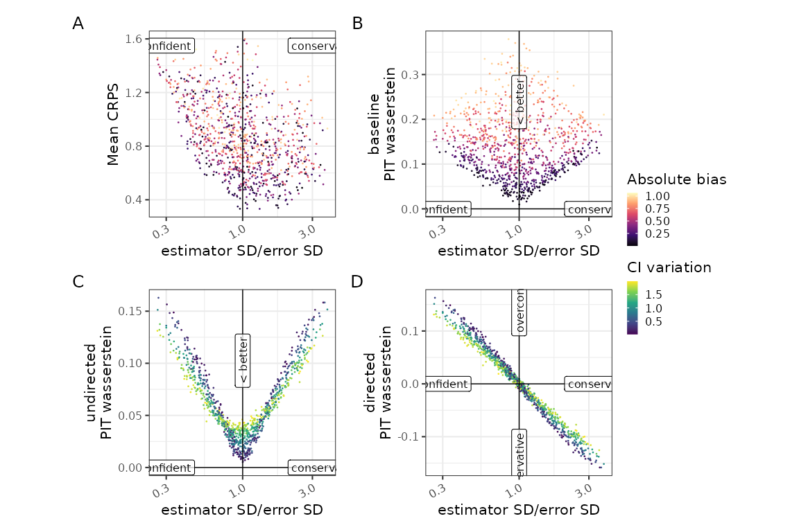
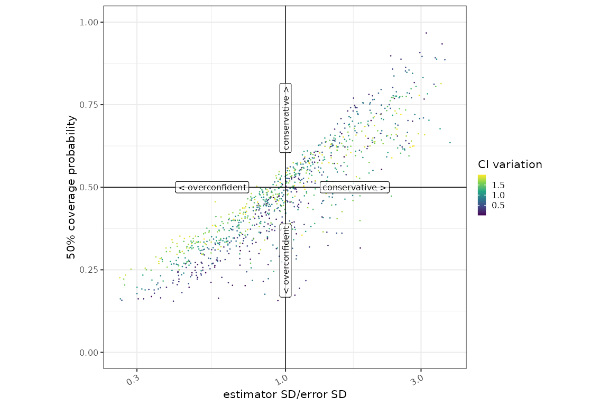

# PIT-Wasserstein metrics for miscalibration diagnosis

``` r

# library(pitw)
devtools::load_all()
#> ℹ Loading pitw
library(tidyverse)
#> ── Attaching core tidyverse packages ──────────────────────── tidyverse 2.0.0 ──
#> ✔ dplyr     1.2.1     ✔ readr     2.2.0
#> ✔ forcats   1.0.1     ✔ stringr   1.6.0
#> ✔ ggplot2   4.0.4     ✔ tibble    3.3.1
#> ✔ lubridate 1.9.5     ✔ tidyr     1.3.2
#> ✔ purrr     1.2.2     
#> ── Conflicts ────────────────────────────────────────── tidyverse_conflicts() ──
#> ✖ readr::edition_get()   masks testthat::edition_get()
#> ✖ dplyr::filter()        masks stats::filter()
#> ✖ dplyr::lag()           masks stats::lag()
#> ✖ readr::local_edition() masks testthat::local_edition()
#> ℹ Use the conflicted package (<http://conflicted.r-lib.org/>) to force all conflicts to become errors
.gg_pedantic(size = 0.5)
#> Warning: The requested font(s): [Roboto], are not present on the system. Alternatives will be used.
#> This warning is displayed once per session.
fig_dir = here::here("vignettes", "main", "fig")
set.seed(1001)
```

We simulated sets of forecasts with known location bias and predictive
spread to examine how the three PIT-Wasserstein scores distinguish these
sources of miscalibration, and compared the scores with the continuous
ranked probability score (CRPS) and interval coverage. The simulations
provide the results in Figure 1 of the paper.

## 1. The simulation

We compare the scores across a range of ratios of reported spread to
error spread, \\\sigma\_\mathcal{S}/\sigma\_\mathcal{E}\\. A ratio below
one represents overconfidence and a ratio above one represents
underconfidence.

### 1.1 The error-function model

Each simulated **estimator** is defined by two distributions, following
the structure introduced in
[`vignette("introduction-to-pit")`](https://ai4ci.github.io/pit-wasserstein/articles/introduction-to-pit.md):

| Component | Symbol | Role |
|----|----|----|
| error distribution | \\\mathcal{E} \sim \mathcal{N}(\mu\_\mathcal{E}, \sigma\_\mathcal{E})\\ | Difference between the central estimate and the reference value |
| spread distribution | \\\mathcal{S} \sim \mathrm{LogNormal}(\sigma\_\mathcal{S}, \kappa\_\mathcal{S})\\ | Uncertainty reported for each prediction |

For each of the estimator’s predictions \\i\\ we draw a true value
\\x_i\\, an error \\e_i \sim \mathcal{E}\\ and a claimed uncertainty
\\s_i \sim \mathcal{S}\\, and emit the probabilistic prediction

\\ \hat{X}\_i \\\sim\\ \mathcal{N}\\\left(x_i + e_i,\\ s_i\right) \\

The simulations vary three aspects of the forecasts.

- \\\mu\_\mathcal{E}\\ — **bias**. The systematic displacement of the
  central estimate. Zero means unbiased.
- \\\sigma\_\mathcal{S}/\sigma\_\mathcal{E}\\ gives the spread ratio,
  labelled `calibration` in the code and used on the horizontal axes.
- \\\kappa\_\mathcal{S}\\ is the coefficient of variation of the
  reported uncertainty, labelled “CI variation” in the figures. At zero,
  every prediction reports the same spread. At larger values, reported
  spread varies independently of the errors, a form of miscalibration we
  call **spread–error decoupling**.

The spread distribution is lognormal (`lnorm4`, parametrised by median
and coefficient of variation) because a claimed uncertainty must be
positive and because it makes \\\kappa\_\mathcal{S}\\ scale-free.

### 1.2 The parameter sweep

We simulate 1,000 estimators, each making 1,000 predictions. We draw the
bias, error scale, typical reported spread and variation in reported
spread once per estimator, and a reference value, a location error and a
reported spread for each prediction.

| Parameter | Drawn as | Range |
|----|----|----|
| true values \\x_i\\ | \\\mathrm{Uniform}(-1, 1)\\ | per prediction |
| bias \\\mu\_\mathcal{E}\\ | \\\mathrm{Uniform}(-1, 1)\\ | per estimator |
| error scale \\\sigma\_\mathcal{E}\\ | \\\log\\-uniform | \\\[\tfrac12, 2\]\\ |
| claimed scale \\\sigma\_\mathcal{S}\\ | \\\log\\-uniform | \\\[\tfrac12, 2\]\\ |
| decoupling \\\kappa\_\mathcal{S}\\ | \\\mathrm{Uniform}(0, 2)\\ | per estimator |

The independent log-uniform draws of \\\sigma\_\mathcal{S}\\ and
\\\sigma\_\mathcal{E}\\ give ratios from \\\tfrac14\\ to 4. The log
scale places a ratio of \\\tfrac12\\ the same distance from one as a
ratio of 2. We draw bias independently of the ratio so that we can
compare scores at similar ratios for estimators with different biases.

``` r

bias_limit = 1
conf_range = 2

config = tibble(
  sd_sd_mean = c(conf_range),
  sd_label = forcats::as_factor(c("heterogenous CIs"))
) %>%
  group_by(sd_label, sd_sd_mean) %>%
  reframe(
    samples = 1000,
    bias_dist = "norm",
    bias_location = runif(1000, -bias_limit, bias_limit),
    bias_scale = exp(runif(1000, -log(conf_range), log(conf_range))),
    sharpness_dist = "lnorm4",
    sharpness_location = exp(runif(1000, -log(conf_range), log(conf_range))),
    sharpness_scale = runif(1000, 0, sd_sd_mean)
  )
```

[`generate_simulation()`](https://ai4ci.github.io/pit-wasserstein/reference/generate_simulation.md)
expands that configuration into 1000 × 1000 individual predictions, and
[`prediction_scores()`](https://ai4ci.github.io/pit-wasserstein/reference/prediction_scores.md)
collapses each estimator’s 1000 predictions back to one row of scores.

``` r

sim = config %>% generate_simulation(true_value_fn = function(n) runif(n, -1, 1))
#> interfacer: development mode active (test environment).
#> This message is displayed once every 8 hours.
#> Warning: unexpected groups in the return value of generate_simulation(...):
#> observed: sd_label+sd_sd_mean+samples+bias_dist+bias_location+bias_scale+sharpness_dist+sharpness_location+sharpness_scale+link+dist+run_id+calibration+adjust
#> expected: <any>+dist+link+calibration+adjust
#> Warning: ireturn validation did not pass without changing the value.
scores = sim %>% prediction_scores()
```

## 2. The metrics

Full definitions and derivations are in the paper; this is the working
summary. For each estimator, the PIT values \\u_i = F_i(x_i)\\ are
sorted and compared against the uniform plotting positions \\r_i = (i -
\tfrac12)/n\\:

\\ B\_{pit} = \frac1n\sum_i \left\| r_i - u\_{(i)} \right\| \\

This is the 1-Wasserstein distance to a discrete uniform distribution on
the \\n\\ midpoints. The distance to the continuous uniform distribution
differs by at most \\1/(4n)\\. Even independent uniform PIT values
generally give a positive score in a finite sample.

The **bias adjustment** estimates one location shift, \\\hat\delta =
\mathrm{median}\_i(g(m_i) - g(x_i))\\ on the link scale, applies it to
the observations, and recomputes the PIT values as \\u^{adj}\\. Applying
the same two summaries to the adjusted values gives

\\ U\_{pit} = \frac1n\sum_i \left\| r_i - u^{adj}\_{(i)} \right\|,
\qquad D\_{pit} = \frac1n\sum_i \left( r_i - u^{adj}\_{(i)}
\right)\mathrm{sgn}\\\left(\tfrac12 - r_i\right) \\

\\U\_{pit}\\ measures the remaining distance after fitting the common
shift. For a forecast with intervals that are too narrow, the low PIT
values fall below their ranks and the high PIT values exceed theirs. The
signed weight makes both contributions positive. Intervals that are too
wide tend to give negative contributions in both halves. Departures in
opposing directions can cancel in \\D\_{pit}\\.

| Metric | Range | Reads |
|----|----|----|
| \\B\_{pit}\\ | \\\[0, \tfrac12\]\\ | total miscalibration, bias included |
| \\U\_{pit}\\ | \\\[0, \tfrac12\]\\ | miscalibration with bias removed |
| \\D\_{pit}\\ | \\\[-\tfrac14, \tfrac14\]\\ | signed dispersion error: \\+\\ over-confident, \\-\\ conservative |

All three are returned by
[`prediction_scores()`](https://ai4ci.github.io/pit-wasserstein/reference/prediction_scores.md)
alongside the mean CRPS and coverage probabilities.

## 3. Figure 1

Each panel plots one score for all 1,000 estimators against the spread
ratio \\\sigma\_\mathcal{S}/\sigma\_\mathcal{E}\\ on a log scale. The
vertical line marks a ratio of one, where the typical reported spread
matches the spread of the errors.

``` r

# estimator SD/error SD:
# ratio between the SD of an estimate and the SD of the error function
# a low value means that the estimate is more confident than it should be
# a high value says it is too conservative

# Panel A: mean CRPS

p2a = ggplot(
  scores,
  aes(x = calibration, y = mean_crps, colour = abs(bias))
) +
  geom_point() +
  scale_x_log10() +
  scale_color_viridis_c(name = "Absolute bias",option = "magma") +
  geom_vline(xintercept = 1) +
  annotate(
    geom = "label",
    label = "conservative >",
    x = 1,
    y = Inf,
    hjust = -0.5,
    vjust = 1.5,
    alpha = 0.75
  ) +
  annotate(
    geom = "label",
    label = "< overconfident",
    x = 1,
    y = Inf,
    hjust = 1.5,
    vjust = 1.5,
    alpha = 0.75
  ) +
  ylab("Mean CRPS") +
  theme(aspect.ratio = 1) +
  xlab("estimator SD/error SD")

# Panel B: baseline PIT-Wasserstein

p2b = ggplot(
  scores,
  aes(x = calibration, y = B_pit, colour=abs(bias))
) +
  geom_point() +
  scale_x_log10() +
  scale_color_viridis_c(name = "Absolute bias", option = "magma") +
  xlab("estimator SD/error SD") +
  geom_hline(yintercept = 0) +
  geom_vline(xintercept = 1) +
  annotate(
    geom = "label",
    label = "< better",
    x = 1,
    y = 0,
    hjust = -1.5,
    vjust = 0.5,
    angle = 90,
    alpha = 0.75
  ) +
  annotate(
    geom = "label",
    label = "conservative >",
    x = 1,
    y = 0,
    hjust = -0.5,
    vjust = 0.5,
    alpha = 0.75
  ) +
  annotate(
    geom = "label",
    label = "< overconfident",
    x = 1,
    y = 0,
    hjust = 1.5,
    vjust = 0.5,
    alpha = 0.75
  ) +
  theme(aspect.ratio = 1) +
  ylab("baseline\nPIT wasserstein")

# Panel C: undirected PIT-Wasserstein

p3a = ggplot(
  scores,
  aes(x = calibration, y = U_pit, colour=sharpness_scale)
) +
  geom_point() +
  scale_x_log10() +
  scale_color_viridis_c(name = "CI variation") +
  xlab("estimator SD/error SD") +
  geom_hline(yintercept = 0) +
  geom_vline(xintercept = 1) +
  annotate(
    geom = "label",
    label = "< better",
    x = 1,
    y = 0,
    hjust = -1.5,
    vjust = 0.5,
    angle = 90,
    alpha = 0.75
  ) +
  annotate(
    geom = "label",
    label = "conservative >",
    x = 1,
    y = 0,
    hjust = -0.5,
    vjust = 0.5,
    alpha = 0.75
  ) +
  annotate(
    geom = "label",
    label = "< overconfident",
    x = 1,
    y = 0,
    hjust = 1.5,
    vjust = 0.5,
    alpha = 0.75
  ) +
  theme(aspect.ratio = 1) +
  ylab("undirected\nPIT wasserstein")

# Panel D: directed PIT-Wasserstein

p3b = ggplot(
  scores,
  aes(x = calibration, y = D_pit, colour=sharpness_scale)
) +
  geom_point() +
  scale_x_log10() +
  # facet_wrap(~sd_label)+
  scale_color_viridis_c(name = "CI variation") +
  xlab("estimator SD/error SD") +
  geom_hline(yintercept = 0) +
  geom_vline(xintercept = 1) +
  annotate(
    geom = "label",
    label = "overconfident >",
    x = 1,
    y = 0,
    hjust = -0.5,
    vjust = 0.5,
    angle = 90,
    alpha = 0.75
  ) +
  annotate(
    geom = "label",
    label = "< conservative",
    x = 1,
    y = 0,
    hjust = 1.5,
    vjust = 0.5,
    angle = 90,
    alpha = 0.75
  ) +
  annotate(
    geom = "label",
    label = "conservative >",
    x = 1,
    y = 0,
    hjust = -0.5,
    vjust = 0.5,
    alpha = 0.75
  ) +
  annotate(
    geom = "label",
    label = "< overconfident",
    x = 1,
    y = 0,
    hjust = 1.5,
    vjust = 0.5,
    alpha = 0.75
  ) +
  theme(aspect.ratio = 1) +
  ylab("directed\nPIT wasserstein")

## Combined 4 panel plot

plot_metrics = patchwork::wrap_plots(
  p2a,
  p2b,
  p3a,
  p3b,
  ncol = 2,
  guides = "collect",
  axes = "collect"
) +
  patchwork::plot_annotation(tag_levels = "A")

.gg_save_as(
  plot_metrics,
  file.path(fig_dir, "fig1-metric-compare"),
  size = std_size$two_third,
  formats = c("pdf", "eps")
)
```



Mean CRPS (panel A) was lowest near a spread ratio of one among
estimators with little bias. At similar spread ratios, the larger values
generally came from estimators with greater absolute bias. The baseline
PIT-Wasserstein score \\B\_{pit}\\ also increased with bias and away
from a spread ratio of one (panel B).

The adjusted score \\U\_{pit}\\ was lowest near a spread ratio of one
(panel C). At similar ratios, \\U\_{pit}\\ tended to be higher when
reported uncertainty varied more independently of error, as measured by
\\\kappa\_\mathcal{S}\\.

The directed score \\D\_{pit}\\ crossed zero near a spread ratio of one
(panel D). Negative values indicate conservative forecasts and positive
values indicate overconfident forecasts. The crossing was similar across
values of \\\kappa\_\mathcal{S}\\, and the curve was approximately
symmetric about it on the log scale.

\\D\_{pit}\\ indicates the direction of the spread discrepancy.
\\U\_{pit}\\ also responds to departures that cancel in the signed
score. The [significance
vignette](https://ai4ci.github.io/pit-wasserstein/articles/significance-testing.md)
describes how to compare their values with reference distributions.

### 3.5 Comparison with interval coverage

We also calculated how often the reference value fell inside the
reported intervals.

``` r


ggplot(
  scores,
  aes(x = calibration, y = mean_coverage.0.5, colour=sharpness_scale)
) +
  geom_point() +
  geom_vline(xintercept = 1) +
  geom_hline(yintercept = 0.5) +
  annotate(
    geom = "label",
    label = "conservative >",
    x = 1,
    y = 0.5,
    hjust = -0.5,
    vjust = 0.5,
    angle = 90,
    alpha = 0.75
  ) +
  annotate(
    geom = "label",
    label = "< overconfident",
    x = 1,
    y = 0.5,
    hjust = 1.5,
    vjust = 0.5,
    angle = 90,
    alpha = 0.75
  ) +
  annotate(
    geom = "label",
    label = "conservative >",
    x = 1,
    y = 0.5,
    hjust = -0.5,
    vjust = 0.5,
    alpha = 0.75
  ) +
  annotate(
    geom = "label",
    label = "< overconfident",
    x = 1,
    y = 0.5,
    hjust = 1.5,
    vjust = 0.5,
    alpha = 0.75
  ) +
  ylab("50% coverage probability") +
  theme(aspect.ratio = 1) +
  scale_color_viridis_c(name = "CI variation") +
  scale_x_log10() +
  coord_cartesian(ylim = c(0, 1)) +
  xlab("estimator SD/error SD")
```



Coverage increased with the spread ratio and changed little at the
extremes shown here. Each coverage estimate describes one interval
level. The PIT-Wasserstein scores use information from across the
predictive distribution.
