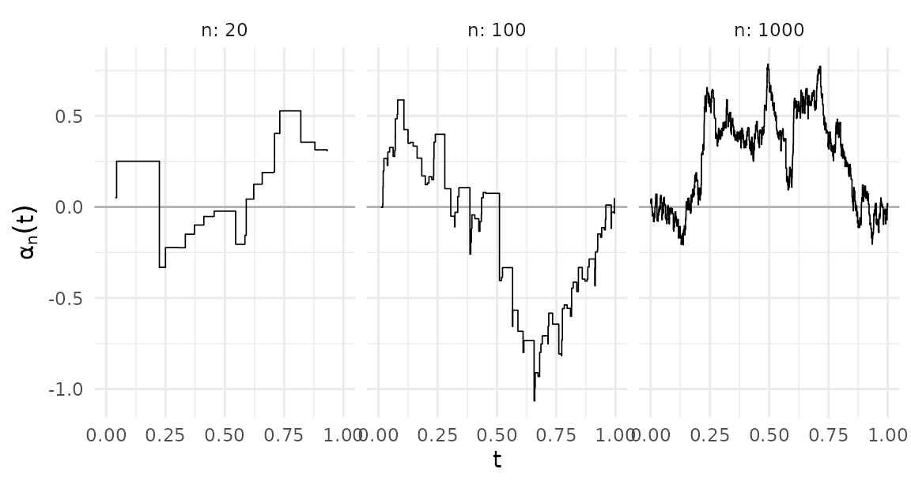
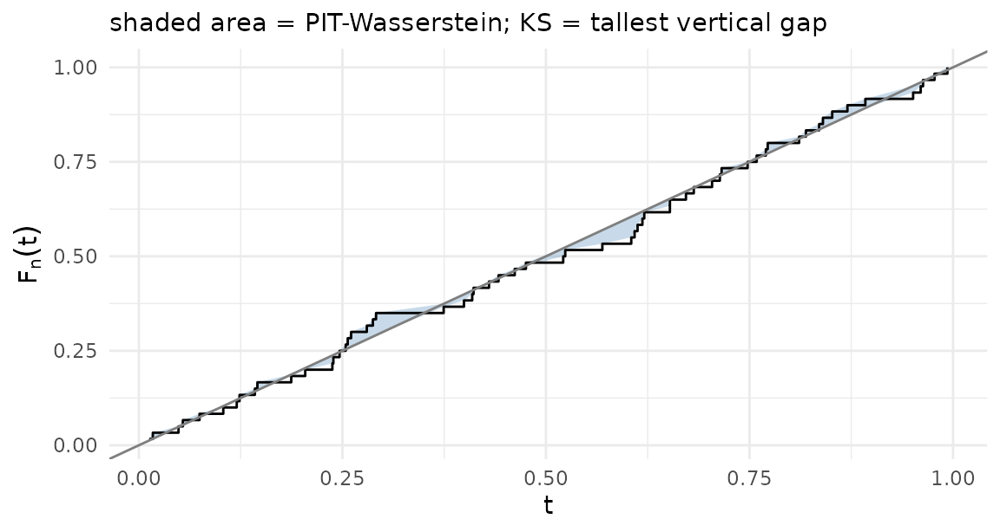

# Significance testing for the PIT-Wasserstein metrics

``` r

# library(pitw)
devtools::load_all()
#> ℹ Loading pitw
library(tidyverse)
#> ── Attaching core tidyverse packages ──────────────────────── tidyverse 2.0.0 ──
#> ✔ dplyr     1.2.1     ✔ readr     2.2.0
#> ✔ forcats   1.0.1     ✔ stringr   1.6.0
#> ✔ ggplot2   4.0.4     ✔ tibble    3.3.1
#> ✔ lubridate 1.9.5     ✔ tidyr     1.3.2
#> ✔ purrr     1.2.2     
#> ── Conflicts ────────────────────────────────────────── tidyverse_conflicts() ──
#> ✖ readr::edition_get()   masks testthat::edition_get()
#> ✖ dplyr::filter()        masks stats::filter()
#> ✖ dplyr::lag()           masks stats::lag()
#> ✖ readr::local_edition() masks testthat::local_edition()
#> ℹ Use the conflicted package (<http://conflicted.r-lib.org/>) to force all conflicts to become errors
set.seed(101)
```

Each test compares a PIT-Wasserstein score with the values expected
under its reference model. The scores measure departures of the
probability integral transform (PIT) values from uniformity. The
reference distributions are large-sample approximations and assume
independent PIT values. In the [EpiEstim
example](https://ai4ci.github.io/pit-wasserstein/articles/sir-epiestim-example.md),
each series contributes one estimate at a given window setting. Pooling
the five settings would count the same series several times.

The [worked example](#in-practice) uses 120 normal forecasts with a
common location bias and reported standard deviations smaller than the
spread of the errors. We score the forecasts with
[`pit_w()`](https://ai4ci.github.io/pit-wasserstein/reference/pit_w.md)
and pass each score and the number of predictions to its significance
function. The signs and \\p\\-values describe different aspects of the
same set of forecasts.

## 1. The reference distribution for uniform PIT values

We compare the cumulative distribution of the PIT values with that of a
uniform distribution. The Brownian bridge describes how this difference
varies across repeated samples of independent uniform PIT values as the
sample size increases.

### 1a. The empirical process

Under the baseline reference model, the PIT values \\u_i = F_i(x_i)\\
are \\n\\ independent draws from \\\mathrm{Uniform}(0,1)\\. The
comparison uses these values, which are on a common scale even when the
predictive distributions differ.

Form the empirical CDF \\F_n(t) = \frac1n\\\\u_i \le t\\\\ and compare
it to the CDF it should have, which is \\F(t) = t\\. The **empirical
process** is the scaled gap between them:

\\ \alpha_n(t) = \sqrt{n}\left(F_n(t) - t\right) \\

The scaled difference has three properties.

1.  **At any fixed \\t\\**, \\nF_n(t) \sim \mathrm{Binomial}(n, t)\\, so
    \\\alpha_n(t)\\ has mean \\0\\ and variance \\t(1-t)\\, and by the
    CLT it is asymptotically normal.
2.  **At two points** \\s \< t\\, the covariance works out as \\s(1-t) =
    s\wedge t - st\\.
3.  **At the ends**, \\\alpha_n(0) = \alpha_n(1) = 0\\ exactly, because
    the empirical CDF is pinned to 0 and 1 at the edges, whatever the
    sample.

The standard Brownian bridge \\B^\circ\\ is a Gaussian process with mean
zero, covariance \\s\wedge t - st\\ and value zero at both endpoints.
Donsker’s theorem gives the limit of the scaled difference.

\\ \alpha_n \\\Rightarrow\\ B^\circ \qquad \text{(Donsker's theorem)} \\

``` r

# The empirical process of uniform PIT values, for increasing n.
tibble(n = c(20L, 100L, 1000L)) |>
  mutate(draw = map(n, ~ {
    u <- sort(runif(.x))
    tibble(t = u, alpha = sqrt(.x) * (seq_along(u) / .x - u))
  })) |>
  unnest(draw) |>
  ggplot(aes(t, alpha)) +
  geom_hline(yintercept = 0, colour = "grey70") +
  geom_step(linewidth = 0.3) +
  facet_wrap(~ n, labeller = label_both) +
  labs(x = "t", y = expression(alpha[n](t))) +
  theme_minimal()
```



The path gets rougher as \\n\\ grows but its *vertical scale does not
change*: that is the \\\sqrt n\\ doing its job. The limiting object is
the same in all three panels.

### 1b. Comparing goodness-of-fit statistics

Several goodness-of-fit tests summarise the difference between these
cumulative distributions. Their reference distributions use the
corresponding summary of \\B^\circ\\.

| Test | Statistic | Limit |
|----|----|----|
| Kolmogorov–Smirnov | \\\sup_t\lvert\alpha_n(t)\rvert\\ | \\\sup_t\lvert B^\circ\rvert\\ |
| Cramér–von Mises | \\\int\alpha_n^2\\ | \\\int (B^\circ)^2\\ |
| Anderson–Darling | \\\int \alpha_n^2 / (t(1-t))\\ | weighted version |
| **PIT-Wasserstein** | \\\int\lvert\alpha_n\rvert\\ | \\\int_0^1\lvert B^\circ\rvert\\ |

KS takes the worst single point (\\L^\infty\\). Cramér–von Mises takes
the mean square (\\L^2\\). **Ours takes the mean absolute gap (the
\\L^1\\ norm), which is the area between the empirical CDF and the
diagonal.** That area is exactly the 1-Wasserstein distance between the
PIT distribution and the uniform, which gives the continuous reference
for our midpoint approximation.

Using the whole difference gives weight to small departures that persist
across the PIT range. The Kolmogorov–Smirnov statistic uses the largest
vertical difference.

``` r

# The same empirical process summarised three ways.
u <- sort(runif(60))
tibble(t = u, Fn = seq_along(u) / 60) |>
  ggplot(aes(t)) +
  geom_ribbon(aes(ymin = pmin(Fn, t), ymax = pmax(Fn, t)),
              fill = "steelblue", alpha = 0.3) +
  geom_step(aes(y = Fn)) +
  geom_abline(slope = 1, intercept = 0, colour = "grey50") +
  labs(x = "t", y = expression(F[n](t)),
       subtitle = "shaded area = PIT-Wasserstein; KS = tallest vertical gap") +
  theme_minimal()
```



### 1c. The effect of estimating a location shift

For the baseline score, the reference is determined by the number of
independent uniform PIT values. Estimating a location shift from the
same forecasts affects the adjusted PIT values and changes their
reference distribution. Section 5 describes this for the undirected
adjusted score.

## 2. The three metrics, and the three hypotheses

Given PIT values \\u_i\\ with order statistics \\u\_{(i)}\\ and uniform
plotting positions \\r_i = (i - \tfrac12)/n\\, we use one statistic

\\ W(u) = \frac1n\sum\_{i=1}^n \left\| r_i - u\_{(i)} \right\| \\

and one signed variant, in which the signed discrepancy is multiplied by
a weight that is \\+1\\ in the lower half of the distribution and \\-1\\
in the upper, so that over- and under-dispersion cancel rather than
accumulate:

\\ D(u) = \frac1n\sum\_{i=1}^n \left( r_i - u\_{(i)}
\right)\\\mathrm{sgn}\\\left(\tfrac12 - r_i\right) \\

The **bias adjustment** estimates a single location shift in the link
scale, \\\hat\delta = \mathrm{median}\_i\left(g(m_i) - g(x_i)\right)\\
for predictive medians \\m_i\\, applies it to the observations, and
re-computes the PITs. Write \\u^{adj}\\ for the result. The three
metrics are then

| Metric | Definition | Large-sample reference |
|----|----|----|
| \\B\_{pit}\\ | \\W(u)\\ | Independent uniform PIT values |
| \\D\_{pit}\\ | \\D(u^{adj})\\ | Independent Gaussian errors with a common standard deviation on the link scale and a fitted median shift |
| \\U\_{pit}\\ | \\W(u^{adj})\\ | The same fitted Gaussian model |

The baseline distance describes pooled PIT uniformity. The adjusted
scores measure the direction and magnitude of the departure left after
fitting a common shift. Their marginal tests use the same observations
and may reject together.

``` r

# Row-wise metrics on a matrix of PIT values: one replicate per row.
pit_metrics <- function(v) {
  n <- ncol(v)
  s <- t(apply(v, 1, sort))
  r <- matrix(seq(0.5 / n, 1 - 0.5 / n, length.out = n), nrow(v), n, byrow = TRUE)
  list(W = rowMeans(abs(r - s)),
       D = rowMeans((r - s) * sign(0.5 - r)))
}

null_pit <- function(n, reps = 4000) matrix(runif(n * reps), reps, n)
```

## 3. The null of `B_pit`: an explicit formula

The difference between the midpoint distance and the distance to
continuous uniformity is at most \\1/(4n)\\. They therefore have the
same scaled limit,

\\ \sqrt{n}\\B\_{pit} \\\Rightarrow\\ \int_0^1 \left\| B^\circ(t)
\right\| \mathrm{d}t \\

Unlike the KS limit this one is not in every textbook, but it *is* known
in closed form. Johnson & Killeen (1983) give the CDF of \\L =
\int_0^1\|B^\circ\|\\ as a rapidly convergent series,

\\ P(L \le \ell) = \sqrt{\pi/2}\sum\_{j\ge1}\delta_j^{-3/2}\\
\psi\\\left(\ell/\delta_j^{3/2}\right), \qquad \psi(t) =
3^{2/3}t^{-1/3}e^{-2/(27t^2)}\\\mathrm{Ai}\\\left((3t)^{-4/3}\right) \\

where \\\mathrm{Ai}\\ is the Airy function, \\a'\_j\\ is the \\j\\th
zero of \\\mathrm{Ai}'\\, and \\\delta_j = \|a'\_j\|/2^{1/3}\\. This is
implemented as
[`p_l1_bridge()`](https://ai4ci.github.io/pit-wasserstein/reference/p_l1_bridge.md)
and
[`q_l1_bridge()`](https://ai4ci.github.io/pit-wasserstein/reference/p_l1_bridge.md);
nothing beyond base R’s Bessel functions is needed, since
\\\mathrm{Ai}\\ on the positive axis is a modified Bessel function in
disguise.

The mean of the limit is known exactly to be \\\sqrt{2\pi}/8 \approx
0.3133\\, which gives a free and rather demanding check on the
implementation:

``` r

tibble(
  quantity = c("mean", "q95", "q99"),
  series   = c(integrate(function(x) 1 - p_l1_bridge(x), 0, 5,
                         subdivisions = 500L)$value,
               q_l1_bridge(0.95), q_l1_bridge(0.99)),
  theory   = c(sqrt(2 * pi) / 8, NA, NA)
)
#> # A tibble: 3 × 3
#>   quantity series theory
#>   <chr>     <dbl>  <dbl>
#> 1 mean      0.313  0.313
#> 2 q95       0.582 NA    
#> 3 q99       0.752 NA
```

At the nominal 5% level we compare \\B\_{pit}\\ with \\0.5821/\sqrt n\\.
[`b_pit_significance()`](https://ai4ci.github.io/pit-wasserstein/reference/b_pit_significance.md)
evaluates the limiting distribution. The table below compares it with
independent uniform samples of finite size.

``` r

map_dfr(c(25L, 50L, 100L, 400L), function(n) {
  b <- pit_metrics(null_pit(n))$W
  tibble(n,
         mean_sqrt_n = sqrt(n) * mean(b),
         theory      = sqrt(2 * pi) / 8,
         q95_sqrt_n  = sqrt(n) * quantile(b, 0.95),
         size_0.05   = mean(b_pit_significance(b, n)$p_value < 0.05))
})
#> # A tibble: 4 × 5
#>       n mean_sqrt_n theory q95_sqrt_n size_0.05
#>   <int>       <dbl>  <dbl>      <dbl>     <dbl>
#> 1    25       0.311  0.313      0.582    0.05  
#> 2    50       0.312  0.313      0.573    0.0455
#> 3   100       0.314  0.313      0.582    0.0505
#> 4   400       0.313  0.313      0.585    0.052
```

Both \\\sqrt n\\\mathbb{E}B\\ and \\\sqrt n\\q\_{0.95}\\ are flat in
\\n\\, confirming the scaling, and the test holds its nominal size.

Takács (1993) gives series for the \\L^1\\ norm of Brownian motion. For
the Brownian bridge we use the result of Johnson and Killeen (1983).

## 4. The Gaussian limit of `D_pit`

Writing \\w(t) = \mathrm{sgn}(\tfrac12 - t)\\, the signed metric is a
**linear** functional of the same process,

\\ \sqrt{n}\\D\_{pit} \\\Rightarrow\\ \int_0^1
w(t)\\B^\circ(t)\\\mathrm{d}t \\

A linear functional of a Gaussian process is Gaussian, so this limit is
normal with mean zero, and its variance is a double integral against the
bridge covariance:

\\ \mathrm{Var}\left( \int_0^1 w B^\circ \right) = \int_0^1\\\\\int_0^1
w(s)w(t)\left(s\wedge t - st\right)\mathrm{d}s\\\mathrm{d}t =
\frac{1}{48} \\

The test therefore uses this large-sample reference:

\\ D\_{pit} \\\approx\\ \mathcal{N}\\\left(0,\\\frac{1}{48n}\right) \\

This is where the \\L^1\\ family stops looking like KS: there is no
signed variant of the supremum norm, because a supremum cannot cancel.
Taking a signed integral is only available to us because we integrate.

``` r

# Simulate Brownian bridges and evaluate both limiting functionals directly.
sim_bridge <- function(reps = 2000, m = 1000) {
  t <- seq_len(m) / m
  incr <- matrix(rnorm(reps * m, sd = sqrt(1 / m)), reps, m)
  w <- t(apply(incr, 1, cumsum))                                     # Wiener
  b <- w - outer(w[, m], t)                                          # bridge
  wt <- matrix(sign(0.5 - t), reps, m, byrow = TRUE)
  list(signed = rowMeans(b * wt), absolute = rowMeans(abs(b)))
}
bridge <- sim_bridge()
tibble(
  quantity  = c("Var(int w B)", "E|int |B||"),
  simulated = c(var(bridge$signed), mean(bridge$absolute)),
  theory    = c(1 / 48, sqrt(2 * pi) / 8)
)
#> # A tibble: 2 × 3
#>   quantity     simulated theory
#>   <chr>            <dbl>  <dbl>
#> 1 Var(int w B)    0.0205 0.0208
#> 2 E|int |B||      0.314  0.313
```

The simulated variance and mean can be compared with \\1/48\\ and
\\\sqrt{2\pi}/8\\, respectively. Both the finite integration grid and
the number of simulated paths affect this comparison. The next table
uses raw uniform PITs to check the signed functional before fitting a
shift.

``` r

map_dfr(c(10L, 25L, 50L, 100L, 400L), function(n) {
  d <- pit_metrics(null_pit(n))$D
  tibble(n,
         n_var_D   = n * var(d),
         theory    = 1 / 48,
         size_0.05 = mean(d_pit_significance(d, n)$p_value < 0.05))
})
#> # A tibble: 5 × 4
#>       n n_var_D theory size_0.05
#>   <int>   <dbl>  <dbl>     <dbl>
#> 1    10  0.0217 0.0208    0.0875
#> 2    25  0.0204 0.0208    0.056 
#> 3    50  0.0214 0.0208    0.0598
#> 4   100  0.0208 0.0208    0.055 
#> 5   400  0.0211 0.0208    0.051
```

The simulation compares the finite-sample variance with \\1/48\\ on the
scaled statistic. At small sample sizes the two-sided test can reject
more often than its nominal 5% level.

## 5. The reference distribution for adjusted PIT values

We estimate the location shift from the same forecasts that we score. In
the common-scale Gaussian model, the reference distribution for
\\U\_{pit}\\ accounts for this estimate. The same principle motivates
the Lilliefors correction for the Kolmogorov–Smirnov test of normality
after estimating the mean and variance from the sample.

Perturbing the location by \\\delta\\ moves each PIT value by
\\\varphi(\Phi^{-1}(t))\delta\\ to first order, and the median centring
pins the process at \\t = \tfrac12\\, so the limit is the bridge with
that direction projected out:

\\ \sqrt{n}\\U\_{pit} \\\Rightarrow\\ \int_0^1 \left\| B^\circ(t) -
\kappa(t)\\B^\circ(\tfrac12) \right\| \mathrm{d}t, \qquad \kappa(t) =
\frac{\varphi(\Phi^{-1}(t))}{\varphi(0)} \\

[`u_pit_significance()`](https://ai4ci.github.io/pit-wasserstein/reference/u_pit_significance.md)
simulates and caches this limit process. The sensitivity above is for a
common-scale Gaussian location model. In that model the limiting
reference for \\\sqrt n\\U\_{pit}\\ is fixed. Under link-scale
adjustment, a different predictive family or varying forecast scales can
change the effect of estimating the location shift.

``` r

# The limit process of section 5, compared to the unprojected bridge.
t <- seq_len(1000) / 1000
kap <- dnorm(qnorm(t)) / dnorm(0)
incr <- matrix(rnorm(4000 * 1000, sd = sqrt(1 / 1000)), 4000, 1000)
w <- t(apply(incr, 1, cumsum))
b <- w - outer(w[, 1000], t)
proj <- b - outer(b[, 500], kap)
tibble(
  limit = c("B (unprojected)", "U (projected)"),
  mean  = c(mean(rowMeans(abs(b))), mean(rowMeans(abs(proj)))),
  q95   = c(quantile(rowMeans(abs(b)), 0.95), quantile(rowMeans(abs(proj)), 0.95))
)
#> # A tibble: 2 × 3
#>   limit            mean   q95
#>   <chr>           <dbl> <dbl>
#> 1 B (unprojected) 0.311 0.569
#> 2 U (projected)   0.237 0.386
```

and against the finite-sample adjusted metric, with genuinely
heteroscedastic calibrated predictions:

``` r

adjusted_pits <- function(n, reps, kappa) {
  mu <- matrix(rnorm(n * reps, 10, 2), reps, n)
  sc <- matrix(exp(rnorm(n * reps, 0, kappa)), reps, n)
  x  <- matrix(rnorm(n * reps, mu, sc), reps, n)
  b  <- apply(mu - x, 1, median)
  pnorm(x + b, mu, sc)
}

pmap_dfr(crossing(n = c(25L, 76L, 400L), kappa = c(0, 0.5)),
         function(n, kappa) {
  u <- pit_metrics(adjusted_pits(n, 2000, kappa))$W
  tibble(n, kappa,
         q95_U = quantile(u, 0.95),
         q95_B = q_l1_bridge(0.95) / sqrt(n),
         ratio = quantile(u, 0.95) / (q_l1_bridge(0.95) / sqrt(n)),
         size  = mean(u_pit_significance(u, n)$p_value < 0.05))
})
#> # A tibble: 6 × 6
#>       n kappa  q95_U  q95_B ratio   size
#>   <int> <dbl>  <dbl>  <dbl> <dbl>  <dbl>
#> 1    25   0   0.0742 0.116  0.637 0.0385
#> 2    25   0.5 0.0751 0.116  0.645 0.0415
#> 3    76   0   0.0429 0.0668 0.643 0.044 
#> 4    76   0.5 0.0436 0.0668 0.654 0.0435
#> 5   400   0   0.0194 0.0291 0.667 0.0515
#> 6   400   0.5 0.0190 0.0291 0.653 0.0475
```

Under the common-scale Gaussian model the 5% critical value for
\\U\_{pit}\\ is about two-thirds of the baseline value. The rows with
varying forecast scales check one particular simulation. Other families
or patterns of variation can change the reference distribution. For
illustration the two package functions assign different tail
probabilities to a score of 0.05 with 76 independent predictions.

``` r

bind_rows(
  b_pit_significance(0.05, 76) |> transmute(null = "baseline (wrong here)", p_value),
  u_pit_significance(0.05, 76) |> transmute(null = "adjusted (correct)", p_value)
)
#> # A tibble: 2 × 2
#>   null                  p_value
#>   <chr>                   <dbl>
#> 1 baseline (wrong here)  0.165 
#> 2 adjusted (correct)     0.0222
```

In the common-scale Gaussian model the location correction is symmetric
about the median. It integrates to zero against the antisymmetric weight
of \\D\_{pit}\\. The same correction changes the absolute area used by
\\U\_{pit}\\.

## 6. Choosing a scale for the adjustment

### 6a. Link-scale and probit adjustments

The package offers a median adjustment on the link scale or on the
probit scale. The paper uses the link scale to represent a common
location bias.

Bias is a location error in \\x\\-space. An \\x\\-space shift \\\delta\\
becomes a **heterogeneous** shift \\\delta/\sigma_i\\ in probit space,
so the correction required on the probit scale depends on the forecast
standard deviation. Under homoscedasticity the two coincide; under
heteroscedasticity they diverge, and the symptom is a loss of the
log-calibration symmetry of the metric.

That symmetry is a theorem, not an observation. With no bias and
constant \\\sigma\\ the probit-transformed PIT values are exactly \\z_i
\sim \mathcal{N}(0, s)\\ with \\s = \sigma_E/\sigma_S\\, so the PIT CDF
is \\F_s(p) = \Phi(\Phi^{-1}(p)/s)\\ and

\\F\_{1/s}(p) = \Phi\\\left(s\\\Phi^{-1}(p)\right) = F_s^{-1}(p)\\

Inverting a monotone function reflects its graph in the diagonal, which
preserves the area between graph and diagonal. So
\\\int_0^1\|F_s(p)-p\|\\dp\\ is *exactly* invariant under \\c
\leftrightarrow 1/c\\: an estimator twice too wide and one twice too
narrow score identically. The identity concerns population distances for
constant scales.

``` r

asymmetry <- function(c_cal, n = 2000, reps = 400) {
  b  <- runif(reps, -1, 1)
  k  <- runif(reps, 0, 2)
  e  <- matrix(rnorm(n * reps), reps, n) + b
  sc <- matrix(rlnorm(n * reps, log(c_cal), sqrt(log(k^2 + 1))), reps, n)
  z  <- -e / sc
  c(link_space  = mean(pit_metrics(pnorm((-e + apply(e, 1, median)) / sc))$W),
    probit_mean = mean(pit_metrics(pnorm(z - rowMeans(z)))$W),
    probit_med  = mean(pit_metrics(pnorm(z - apply(z, 1, median)))$W))
}
hi <- asymmetry(2); lo <- asymmetry(0.5)
tibble(adjustment = names(hi), U_at_c_2 = hi, U_at_c_half = lo,
       asymmetry_pct = 100 * (hi - lo) / ((hi + lo) / 2))
#> # A tibble: 3 × 4
#>   adjustment  U_at_c_2 U_at_c_half asymmetry_pct
#>   <chr>          <dbl>       <dbl>         <dbl>
#> 1 link_space    0.0867      0.0851          1.91
#> 2 probit_mean   0.0928      0.155         -50.3 
#> 3 probit_med    0.0832      0.0981        -16.4
```

With varying scales, the link adjustment removes the simulated common
bias in outcome units. Centring the probits instead removes a common
shift in standardised errors. The two operations answer different
questions.

### 6b. Directed scores after fitting the shift

``` r

adjusted_null <- function(n, bias, kappa, reps = 4000) {
  e  <- matrix(rnorm(n * reps), reps, n) + bias
  sc <- if (kappa == 0) matrix(1, reps, n) else
        matrix(rlnorm(n * reps, 0, sqrt(log(kappa^2 + 1))), reps, n)
  d  <- pit_metrics(pnorm((-e + apply(e, 1, median)) / sc))$D
  tibble(n, bias, kappa, n_var_D = n * var(d),
         size = mean(d_pit_significance(d, n)$p_value < 0.05))
}
pmap_dfr(crossing(n = c(100L, 400L), bias = c(0, 1), kappa = c(0, 0.5, 2)),
         adjusted_null) |>
  mutate(theory = 1 / 48)
#> # A tibble: 12 × 6
#>        n  bias kappa n_var_D   size theory
#>    <int> <dbl> <dbl>   <dbl>  <dbl>  <dbl>
#>  1   100     0   0    0.0207 0.0492 0.0208
#>  2   100     0   0.5  0.0223 0.057  0.0208
#>  3   100     0   2    0.0325 0.124  0.0208
#>  4   100     1   0    0.0204 0.0495 0.0208
#>  5   100     1   0.5  0.0230 0.0648 0.0208
#>  6   100     1   2    0.0329 0.123  0.0208
#>  7   400     0   0    0.0207 0.048  0.0208
#>  8   400     0   0.5  0.0236 0.0672 0.0208
#>  9   400     0   2    0.0346 0.127  0.0208
#> 10   400     1   0    0.0205 0.0488 0.0208
#> 11   400     1   0.5  0.0243 0.0707 0.0208
#> 12   400     1   2    0.0328 0.120  0.0208
```

With \\\kappa = 0\\, the location adjustment cancels to first order in
the Gaussian limit. In the simulation, \\n\mathrm{Var}(D)\\ stays near
\\1/48\\ and the rejection rate is close to nominal with or without a
common bias.

At \\\kappa\>0\\ reported spreads vary independently of the size of the
errors. The rejection proportions in those rows describe a departure
from the reference model.

## 7. What exactly is the null hypothesis?

The following simulation keeps the median reported spread equal to the
error standard deviation and varies the spread from case to case. We
compare the resulting PIT tail frequency with the 10% expected under
uniformity.

``` r

map_dfr(c(0, 0.25, 0.5, 1, 2), function(k) {
  n <- 5000; reps <- 200
  e  <- matrix(rnorm(n * reps), reps, n)
  sc <- if (k == 0) matrix(1, reps, n) else
        matrix(rlnorm(n * reps, 0, sqrt(log(k^2 + 1))), reps, n)
  u <- pnorm(-e / sc)
  tibble(kappa = k,
         E_B_pit   = mean(pit_metrics(u)$W),
         tail_mass = mean(u < 0.05 | u > 0.95))   # uniform => 0.10
})
#> # A tibble: 5 × 3
#>   kappa E_B_pit tail_mass
#>   <dbl>   <dbl>     <dbl>
#> 1  0    0.00453     0.100
#> 2  0.25 0.00571     0.116
#> 3  0.5  0.0115      0.147
#> 4  1    0.0253      0.200
#> 5  2    0.0411      0.253
```

So \\H_0\\ for \\B\_{pit}\\ is not “the median predictive width is
correct”. It is PIT uniformity, which in this simulation family requires
the dispersion ratio \\c = 1\\ *and* \\\kappa = 0\\.

Here \\\kappa\>0\\ means that the reported spread varies independently
of the error distribution. A correctly specified heteroscedastic
forecast can also report different spreads. If the conditional
distribution of the outcome matches each forecast, the PIT values are
uniform.

## 8. Reading the three tests together

The metrics respond to \\\kappa\\ quite differently, and the contrast is
useful rather than inconvenient:

``` r

sweep_c <- function(c_cal, kappa, n = 20000, reps = 100) {
  e  <- matrix(rnorm(n * reps), reps, n)
  sc <- if (kappa == 0) matrix(c_cal, reps, n) else
        matrix(rlnorm(n * reps, log(c_cal), sqrt(log(kappa^2 + 1))), reps, n)
  m <- pit_metrics(pnorm((-e + apply(e, 1, median)) / sc))
  tibble(c_cal, kappa, U = mean(m$W), D = mean(m$D))
}
pmap_dfr(crossing(c_cal = c(0.5, 0.8, 1, 1.25, 2), kappa = c(0, 0.5, 1, 2)),
         sweep_c) |>
  pivot_wider(names_from = c_cal, values_from = c(U, D)) |>
  print(width = Inf)
#> # A tibble: 4 × 11
#>   kappa  U_0.5  U_0.8     U_1 U_1.25    U_2  D_0.5  D_0.8        D_1  D_1.25
#>   <dbl>  <dbl>  <dbl>   <dbl>  <dbl>  <dbl>  <dbl>  <dbl>      <dbl>   <dbl>
#> 1   0   0.102  0.0353 0.00176 0.0353 0.102  0.102  0.0353  0.0000194 -0.0353
#> 2   0.5 0.0950 0.0322 0.0110  0.0328 0.0951 0.0950 0.0322 -0.0000470 -0.0321
#> 3   1   0.0843 0.0308 0.0252  0.0370 0.0848 0.0843 0.0278 -0.000203  -0.0283
#> 4   2   0.0719 0.0424 0.0410  0.0474 0.0776 0.0715 0.0236 -0.000151  -0.0237
#>       D_2
#>     <dbl>
#> 1 -0.102 
#> 2 -0.0951
#> 3 -0.0842
#> 4 -0.0715
```

In this simulation the average directed score stays near zero at \\c=1\\
as \\\kappa\\ increases. The average unsigned score increases.
Independent variation in the scales can put excess PIT mass both near
the endpoints and near the centre. Some departures then cancel in the
directed score.

At \\n=200\\, what fraction of replicate sets gives a rejection at the
nominal 5% threshold? We calculate all three proportions for each of six
scenarios, fitting a separate median shift in each replicate.

``` r

scenario <- function(label, bias, c_cal, kappa, n = 200L, reps = 400) {
  e  <- matrix(rnorm(n * reps), reps, n) + bias
  sc <- if (kappa == 0) matrix(c_cal, reps, n) else
        matrix(rlnorm(n * reps, log(c_cal), sqrt(log(kappa^2 + 1))), reps, n)
  B  <- pit_metrics(pnorm(-e / sc))$W                       # unadjusted
  m  <- pit_metrics(pnorm((-e + apply(e, 1, median)) / sc))         # adjusted
  tibble(label, bias, c_cal, kappa,
         B_pit = mean(b_pit_significance(B, n)$p_value < 0.05),
         D_pit = mean(d_pit_significance(m$D, n)$p_value < 0.05),
         U_pit = mean(u_pit_significance(m$W, n)$p_value < 0.05))
}
pmap_dfr(tribble(
  ~label,                  ~bias, ~c_cal, ~kappa,
  "calibrated",                0,      1,      0,
  "pure bias",                 1,      1,      0,
  "over-confident",            0,    0.7,      0,
  "over-conservative",         0,    1.3,      0,
  "spread-error decoupling",   0,      1,      1,
  "bias + over-conservative",  1,    1.3,      0
), scenario)
#> # A tibble: 6 × 7
#>   label                     bias c_cal kappa  B_pit  D_pit  U_pit
#>   <chr>                    <dbl> <dbl> <dbl>  <dbl>  <dbl>  <dbl>
#> 1 calibrated                   0   1       0 0.0525 0.0475 0.0375
#> 2 pure bias                    1   1       0 1      0.0475 0.0375
#> 3 over-confident               0   0.7     0 0.97   1      1     
#> 4 over-conservative            0   1.3     0 0.665  0.99   0.98  
#> 5 spread-error decoupling      0   1       1 0.192  0.09   0.68  
#> 6 bias + over-conservative     1   1.3     0 1      0.988  0.96
```

A common shift produces a large baseline distance in this simulation. A
pure width error can also produce a large baseline distance and can
cause all three tests to reject. The sign of \\D\_{pit}\\ then gives the
net direction of the remaining error. Under independently varying
spread, \\U\_{pit}\\ can detect departures that largely cancel in
\\D\_{pit}\\. A shape error can give a similar pattern. The table
reports marginal rejection rates for known scenarios. It supplies
neither a unique diagnosis nor a joint 5% test.

## 9. In practice

We simulate 120 observations from normal distributions with means 0.8
above their forecast means. Each forecast reports a standard deviation
of one, while the standard deviation of the simulated errors is 1.4.

``` r

set.seed(2024)
n  <- 120
mu <- rnorm(n, 10, 2)
sc <- rep(1, n)
x  <- rnorm(n, mu + 0.8, 1.4)     # biased AND over-confident

s <- pit_w(x, mu, sc, dist = "norm", link = "identity")

bind_rows(
  b_pit_significance(s$B_pit, n) |> transmute(metric = "B_pit", value = B_pit, p_value),
  d_pit_significance(s$D_pit, n) |> transmute(metric = "D_pit", value = D_pit, p_value),
  u_pit_significance(s$U_pit, n) |> transmute(metric = "U_pit", value = U_pit, p_value)
)
#> # A tibble: 3 × 3
#>   metric  value  p_value
#>   <chr>   <dbl>    <dbl>
#> 1 B_pit  0.227  1.67e-15
#> 2 D_pit  0.0351 7.72e- 3
#> 3 U_pit  0.0369 3.79e- 2
```

All three tests reject in this example. The positive \\D\_{pit}\\ is
consistent with the reported spread being too narrow. We know the bias
and the distributional family from the simulation design. The baseline
score was \\0.227\\. The adjusted scores were \\0.035\\ for \\D\_{pit}\\
and \\0.037\\ for \\U\_{pit}\\.

[`prediction_scores()`](https://ai4ci.github.io/pit-wasserstein/reference/prediction_scores.md)
additionally reports `n_predictions`, so the three tests can be applied
directly to a table of scored forecasters.

## 10. Caveats

**Independence.** Here \\n\\ counts independent predictions. Rolling
estimates from one series may share observations or be correlated even
when their windows do not overlap. The nominal thresholds can then
misstate the evidence. In the EpiEstim study each comparison uses
independent replicates.

**Small \\n\\.** All three tests use limiting reference distributions.
In the simulated Gaussian setting, the \\D\_{pit}\\ normal approximation
is mildly anti-conservative below \\n \approx 50\\ (empirical size
around 8% at \\n = 10\\).

**Skewed predictive families.** Constructing a *calibrated* example
outside log-symmetric families needs care, independently of any of the
above. For a scale family \\X = \mu W\\ with \\\mathrm{median}(W) = 1\\,
placing predictions at \\\mu_i = F_W^{-1}(q_i)\\ gives \\u_i =
F_W(x_0/\mu_i)\\, which is uniform only if \\W \overset{d}{=} 1/W\\,
which is true for `lnorm4` but false for `gamma4`. The correct placement
solves \\F(x_0;\mu_i) = 1 - q_i\\:

``` r

calibrated_locations <- function(qs, x0, kappa, qfn) x0 / qfn(1 - qs, 1, kappa)

qs <- seq(1, 199, 2) / 200
tibble(
  placement = c("naive quantiles", "calibrated"),
  B_pit = c(
    pit_w(2.5, qgamma4(qs, 2.5, 0.5), 0.5, dist = "gamma4", link = "log")$B_pit,
    pit_w(2.5, calibrated_locations(qs, 2.5, 0.5, qgamma4), 0.5,
          dist = "gamma4", link = "log")$B_pit)
)
#> # A tibble: 2 × 2
#>   placement          B_pit
#>   <chr>              <dbl>
#> 1 naive quantiles 2.35e- 2
#> 2 calibrated      7.11e-17
```

Use \\B\_{pit}\\ rather than \\U\_{pit}\\ for this kind of construction
check: it asks the unconditional question and does not estimate anything
from the sample.

## Summary

- The PIT values of a calibrated forecaster are uniform, so the gap
  between their empirical CDF and the diagonal converges to a **Brownian
  bridge**. The limiting Wasserstein statistic uses its \\L^1\\ norm and
  Kolmogorov–Smirnov uses its supremum.
- \\\sqrt n\\B\_{pit} \Rightarrow \int_0^1\|B^\circ\|\\, with an
  explicit CDF from Johnson & Killeen (1983): a 5% critical value of
  \\0.5821/\sqrt n\\.
- \\\sqrt n\\D\_{pit} \Rightarrow \mathcal{N}(0, 1/48)\\ under the
  stated assumptions. The finite-sample test uses this limit as an
  approximation.
- The bias adjustment estimates a parameter from the same data, so
  \\U\_{pit}\\ needs its own null, which is the **Lilliefors step**. Its
  critical value is two thirds of \\B\_{pit}\\’s in the Gaussian
  reference model. In that model the location adjustment cancels to
  first order for \\D\_{pit}\\.
- The adjustment must live in the link scale, not in PIT space, or
  bias-invariance under heteroscedasticity is lost.
- \\H_0\\ is PIT uniformity, which is stronger than “the median width is
  correct”: spread–error decoupling is an alternative, not a null.
- Report all three with their \\p\\-values and interpret them alongside
  the fitted shift and the forecast design. The three tests use the same
  predictions.
