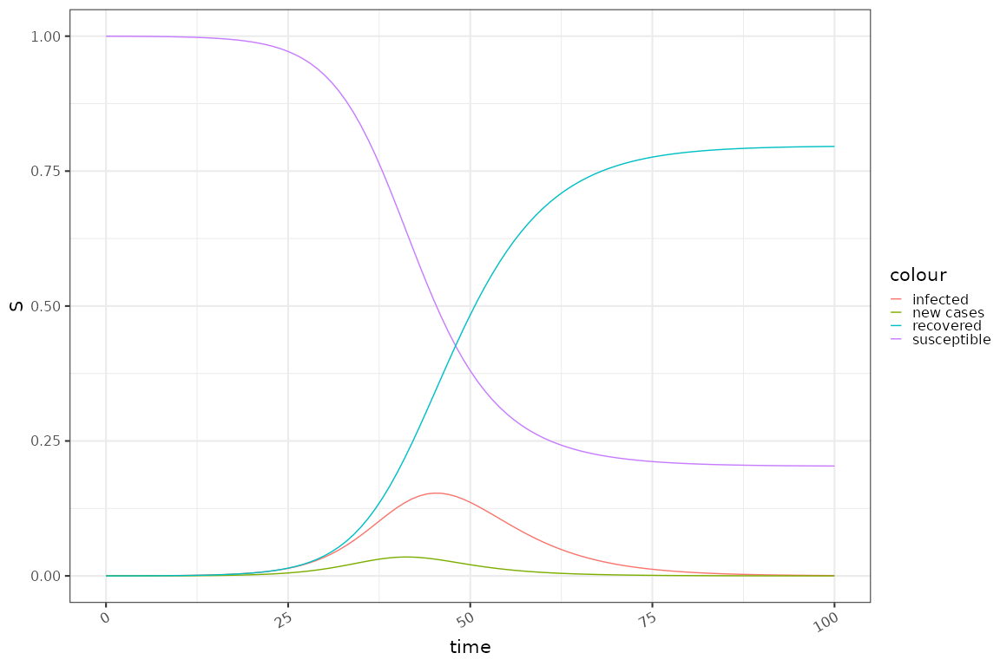
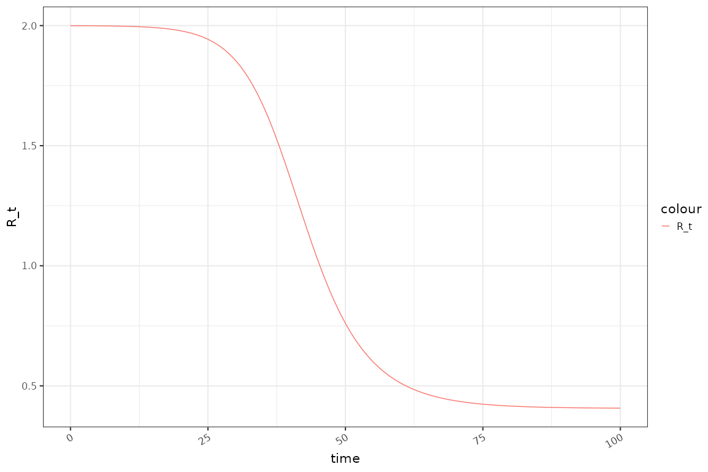
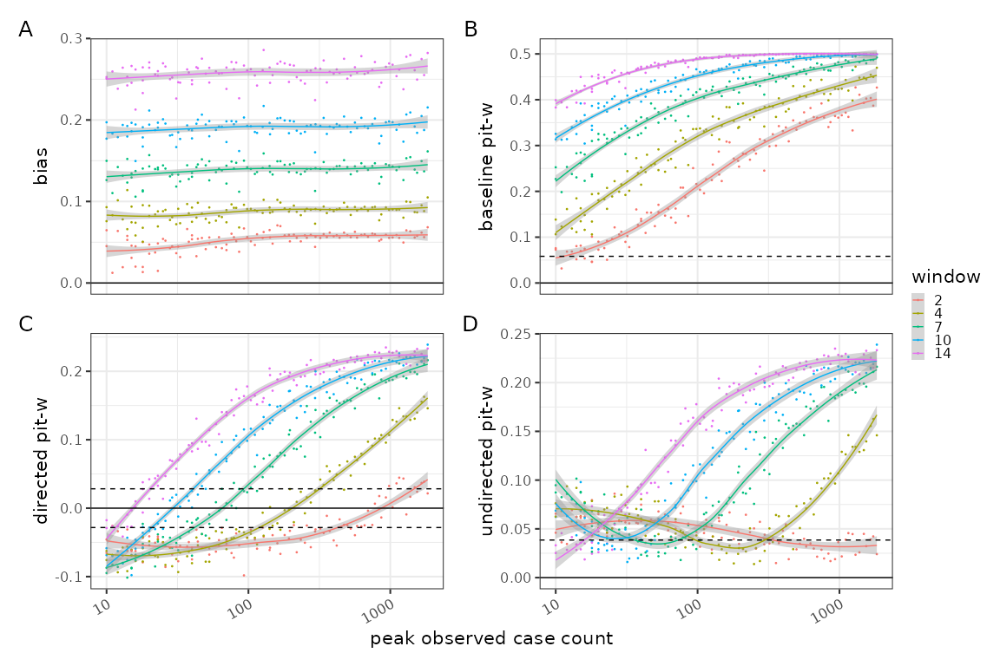
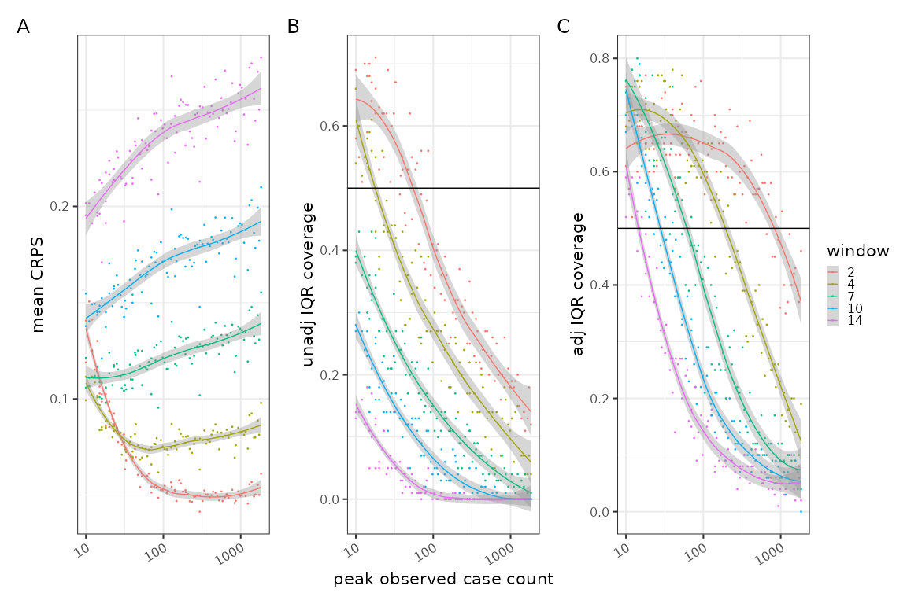

# A PIT-Wasserstein study using SIR dynamics and EpiEstim

``` r

devtools::load_all(quiet = TRUE)
library(tidyverse)
#> ── Attaching core tidyverse packages ──────────────────────── tidyverse 2.0.0 ──
#> ✔ dplyr     1.2.1     ✔ readr     2.2.0
#> ✔ forcats   1.0.1     ✔ stringr   1.6.0
#> ✔ ggplot2   4.0.4     ✔ tibble    3.3.1
#> ✔ lubridate 1.9.5     ✔ tidyr     1.3.2
#> ✔ purrr     1.2.2     
#> ── Conflicts ────────────────────────────────────────── tidyverse_conflicts() ──
#> ✖ readr::edition_get()   masks testthat::edition_get()
#> ✖ dplyr::filter()        masks stats::filter()
#> ✖ dplyr::lag()           masks stats::lag()
#> ✖ readr::local_edition() masks testthat::local_edition()
#> ℹ Use the conflicted package (<http://conflicted.r-lib.org/>) to force all conflicts to become errors
.gg_pedantic(size = 0.5)
#> Warning: The requested font(s): [Roboto], are not present on the system. Alternatives will be used.
#> This warning is displayed once per session.
fig_dir = here::here("vignettes", "main", "fig")
set.seed(1001)
```

## Purpose

We asked whether EpiEstim’s intervals for the instantaneous reproduction
number were too wide or too narrow, and whether this depended on the
number of observed cases and the estimation window. A simulated epidemic
gives us a reference \\R_t\\ for each day. At a given population size
and window setting, each independent series of case counts contributes
one estimate to the comparison.

## 1. Simulation setup

We solved a deterministic SIR model on the proportion scale for days 0
to 100, with \\R_0=2\\, a mean infectious period of five days and an
initial infectious proportion of \\10^{-4}\\. If \\S_t\\ is the
susceptible proportion, the reference reproduction number is \\R_t=R_0
S_t\\. Multiplying the daily incidence rate \\\beta S_t I_t\\ by
population size gives the expected count used below.

``` r


sir_model = function(t, R0, g) {
  
  init <- c(S=1-1e-4, I=1e-4, R=0)
  parameters <- c(beta=R0 * g, gamma=g)
  time <- seq(0,t,length.out = t+1)
  
  eqn <- function(time,state,parameters){
    with(as.list(c(state,parameters)),{
      dS <- -beta*S*I
      dI <- beta*S*I-gamma*I
      dR <- gamma*I
      return(list(c(dS,dI,dR)))})
  }
  out = deSolve::ode(y=init,times=time,eqn,parms=parameters)
  out = as.data.frame(out)
  out %>% mutate(
    R_t = R0 * S,
    incid = parameters["beta"]*S*I
  )
  
}

tmp = sir_model(100, 2, 1/5)

ggplot(tmp, aes(x=time))+
  geom_line(aes(y=S,colour = "susceptible"))+
  geom_line(aes(y=I,colour = "infected"))+
  geom_line(aes(y=incid,colour = "new cases"))+
  geom_line(aes(y=R,colour = "recovered"))
```



``` r


ggplot(tmp, aes(x=time))+
  geom_line(
    aes(y=R_t,colour = "R_t")
    
  )
```



### Population sizes and observed counts

We used 100 rounded, log-spaced population sizes from 316 to 100,000. At
each size we kept the epidemic curve fixed and generated 100 independent
series of observed daily counts. On each day the number observed was a
binomial draw from the rounded model count with ascertainment
probability 0.5. There was no observation delay.

``` r

scenarios = tidyr::crossing(
  N = round(10 ^ seq(2.5,5,length.out=100)),
  pObs = 0.5, #c(0.2, 0.8),
  run = 1:100
) %>% 
  dplyr::cross_join(tmp) %>%
  dplyr::mutate(
    cases = round(incid*N),
    obs = rbinom(dplyr::n(), cases, pObs)
  ) %>%
  dplyr::group_by(run,N,pObs) %>%
  dplyr::glimpse()
#> Rows: 1,010,000
#> Columns: 11
#> Groups: run, N, pObs [10,000]
#> $ N     <dbl> 316, 316, 316, 316, 316, 316, 316, 316, 316, 316, 316, 316, 316,…
#> $ pObs  <dbl> 0.5, 0.5, 0.5, 0.5, 0.5, 0.5, 0.5, 0.5, 0.5, 0.5, 0.5, 0.5, 0.5,…
#> $ run   <int> 1, 1, 1, 1, 1, 1, 1, 1, 1, 1, 1, 1, 1, 1, 1, 1, 1, 1, 1, 1, 1, 1…
#> $ time  <dbl> 0, 1, 2, 3, 4, 5, 6, 7, 8, 9, 10, 11, 12, 13, 14, 15, 16, 17, 18…
#> $ S     <dbl> 0.9999000, 0.9998556, 0.9998013, 0.9997349, 0.9996542, 0.9995556…
#> $ I     <dbl> 0.0001000000, 0.0001222139, 0.0001493548, 0.0001825164, 0.000222…
#> $ R     <dbl> 0.000000e+00, 2.221940e-05, 4.936983e-05, 8.254702e-05, 1.229050…
#> $ R_t   <dbl> 1.999800, 1.999711, 1.999603, 1.999470, 1.999308, 1.999111, 1.99…
#> $ incid <dbl> 3.999600e-05, 4.887849e-05, 5.973006e-05, 7.298722e-05, 8.910911…
#> $ cases <dbl> 0, 0, 0, 0, 0, 0, 0, 0, 0, 0, 0, 0, 0, 0, 0, 0, 0, 0, 0, 1, 1, 1…
#> $ obs   <int> 0, 0, 0, 0, 0, 0, 0, 0, 0, 0, 0, 0, 0, 0, 0, 0, 0, 0, 0, 1, 0, 0…

# ggplot(scenarios, aes(x=time, group=run))+
#   facet_grid(as.factor(N) ~ as.factor(pObs), scales = "free")+
#   geom_step(aes(y=obs))
  
```

## 2. Estimating \\R_t\\ with EpiEstim

For each series we chose one endpoint uniformly from incidence-vector
indices 40 to 75. At that endpoint we fitted EpiEstim using five
windows, with `t_end - t_start` equal to 2, 4, 7, 10 or 14. These are
the labels used in the figures. EpiEstim includes both endpoints, so the
corresponding windows contain 3, 5, 8, 11 or 15 daily counts. We used a
parametric serial interval with mean and standard deviation both five
days, and a prior for \\R_t\\ with mean 2 and standard deviation 5.

The first entry of the incidence vector is simulation day 0. A window
ending at index 40 therefore includes counts through day 39. The join
below compares it with the reference \\R_t\\ on day 40. This one-day
difference matters when interpreting bias because \\R_t\\ falls over the
course of this epidemic.

``` r


results = scenarios %>% dplyr::group_modify(function(d,g,...) {
  
  # Fit all five windows at one endpoint in this replicate.

  endpoint = sample(50-14,1) + 14 +25
  starts = endpoint-c(2,4,7,10,14)
  ends = rep(endpoint,length(starts))
  
  ee = suppressWarnings(EpiEstim::estimate_R(
    incid = data.frame(I = d$obs),
    method = "parametric_si",
    config = EpiEstim::make_config(
      method = "parametric_si",
      mean_si = 5, std_si = 5,
      t_start = starts, t_end = ends,
      mean_prior = 2, std_prior = 5
    )
  ))
  
  tmp = d %>% 
    # filter(obs>0) %>% 
    inner_join(
      ee$R %>% 
        mutate(window = t_end-t_start) %>%
        select(time = t_end, window=window, mean=`Mean(R)`, sd = `Std(R)`), 
      by = "time"
    )
  
  return(tmp)
  
})
```

## 3. Scoring

We used each posterior mean and standard deviation to specify a gamma
distribution for \\R_t\\. For each population size and window setting we
scored the 100 estimates together, fitting one median location shift on
the log scale. Each point therefore summarises 100 independent series.
Comparisons across windows are paired because the five fits use the same
series and endpoint.

The horizontal axis is the largest daily count observed across all 100
series at that population size. All five window settings share that
value. We left `calibration` unspecified because the spread-to-error
ratio is unknown. The threshold \\R_t=1\\ is used by the package for its
separate classification summary.

``` r


tmp = scenarios %>% dplyr::group_by(N,pObs) %>% dplyr::summarise(max_obs = max(obs))
#> `summarise()` has regrouped the output.
#> ℹ Summaries were computed grouped by N and pObs.
#> ℹ Output is grouped by N.
#> ℹ Use `summarise(.groups = "drop_last")` to silence this message.
#> ℹ Use `summarise(.by = c(N, pObs))` for per-operation grouping
#>   (`?dplyr::dplyr_by`) instead.

scores = results %>%
  dplyr::transmute(
    window,
    true_value= R_t, location = mean, scale = sd, link="log", dist="gamma2",
    calibration=NA_real_
  ) %>%
  dplyr::group_by(N, pObs, dist, link, calibration, window) %>%
  prediction_scores(threshold = 1) %>% 
  dplyr::inner_join(tmp, by=c("N","pObs"))


plotdata = scores %>% ungroup() %>% mutate(
  H0_B_pit = b_pit_significance(B_pit = B_pit, n_predictions = n_predictions) %>% pull(p_value) > 0.05,
  H0_U_pit = u_pit_significance(U_pit = U_pit, n_predictions = n_predictions) %>% pull(p_value) > 0.05,
  H0_D_pit = d_pit_significance(D_pit = D_pit, n_predictions = n_predictions) %>% pull(p_value) > 0.05,
  `P(obs)`=as.factor(pObs),
  window = as.factor(window)
  # timing = cut(time, c(-Inf,30,60,Inf), labels=c("growth","peak","resolution"))
)

signif = tibble(
  n_predictions = 100,
  B_crit = b_pit_significance(B_pit = NA, n_predictions = n_predictions),
  U_crit = u_pit_significance(U_pit = NA, n_predictions = n_predictions),
  D_crit = d_pit_significance(D_pit = NA, n_predictions = n_predictions)
)
```

## 4. Results

``` r


p5a = ggplot(plotdata, aes(x=max_obs,y=bias, colour=window))+
  geom_point()+
  geom_smooth(se=TRUE)+
  scale_x_log10()+
  xlab("peak observed case count")+
  ylab("bias")+
  geom_hline(yintercept = 0, linetype="solid")

p5b = ggplot(plotdata, aes(x=max_obs, colour = window, y=B_pit))+
  geom_point()+
  geom_smooth(se=TRUE)+
  scale_x_log10()+
  xlab("peak observed case count")+
  ylab("baseline pit-w")+
  geom_hline(yintercept = 0, linetype="solid")+
  geom_hline(yintercept = signif$B_crit$critical_0.05, linetype="dashed")
  #+
  #scale_color_manual(values=list("TRUE"="blue","FALSE"="red"), guide=NULL)

p5c = ggplot(plotdata, aes(x=max_obs, colour = window, y=D_pit))+
  geom_point()+
  geom_smooth(se=TRUE)+
  scale_x_log10()+
  xlab("peak observed case count")+
  ylab("directed pit-w")+
  geom_hline(yintercept = 0, linetype="solid")+
  geom_hline(yintercept = signif$D_crit$critical_0.05, linetype="dashed")+
  geom_hline(yintercept = -signif$D_crit$critical_0.05, linetype="dashed")

  #+
  #scale_color_manual(values=list("TRUE"="blue","FALSE"="red"), guide=NULL)
# 
p5d = ggplot(plotdata, aes(x=max_obs, colour = window,y=U_pit))+
  geom_point()+
  geom_smooth(se=TRUE)+
  scale_x_log10()+
  xlab("peak observed case count")+
  ylab("undirected pit-w")+
  geom_hline(yintercept = 0, linetype="solid")+
  geom_hline(yintercept = signif$U_crit$critical_0.05, linetype="dashed")

p5 = p5a+p5b+p5c+p5d+patchwork::plot_layout(guides="collect",axes="collect")+
  patchwork::plot_annotation(tag_level="A")

.gg_save_as(
  p5,
  file.path(fig_dir, "fig4-epiestim-by-epi-size"),
  size = std_size$two_third,
  formats = c("pdf", "eps")
)
#> `geom_smooth()` using method = 'loess' and formula = 'y ~ x'
#> `geom_smooth()` using method = 'loess' and formula = 'y ~ x'
#> `geom_smooth()` using method = 'loess' and formula = 'y ~ x'
#> `geom_smooth()` using method = 'loess' and formula = 'y ~ x'
#> `geom_smooth()` using method = 'loess' and formula = 'y ~ x'
#> `geom_smooth()` using method = 'loess' and formula = 'y ~ x'
#> `geom_smooth()` using method = 'loess' and formula = 'y ~ x'
#> `geom_smooth()` using method = 'loess' and formula = 'y ~ x'
```



### Interpretation

Panel A shows mean bias on the \\R_t\\ scale, calculated as the
predictive median minus the reference and averaged over the 100 series.
EpiEstim tended to overestimate \\R_t\\, particularly for the longer
windows. A longer window includes earlier days when \\R_t\\ was higher.
The day used for the reference also contributes to this comparison.

The baseline distance in panel B measures the departure from uniformity
before any adjustment. After adjusting for location, the directed score
in panel C tends to be negative at low counts and positive at high
counts. The change from conservative to overconfident estimates occurred
at different case counts for different windows. Panel D shows the
magnitude of the remaining departure. Its minimum also varies with the
window setting.

The dashed lines use \\n=100\\. For the baseline distance the reference
is the large-sample distribution for independent uniform PIT values. For
the two adjusted scores the reference assumes a common-scale Gaussian
model on the link scale. The fitted gamma distributions have varying
scales, so those two lines provide benchmarks for reading the figure.

``` r


p6a = ggplot(plotdata, aes(x=max_obs, colour = window,y=mean_crps))+
  geom_point()+
  geom_smooth(se=TRUE)+
  scale_x_log10()+
  xlab("peak observed case count")+
  ylab("mean CRPS")

p6b = ggplot(plotdata, aes(x=max_obs, colour = window,y=mean_coverage.0.5))+
  geom_point()+
  geom_smooth(se=TRUE)+
  scale_x_log10()+
  xlab("peak observed case count")+
  ylab("unadj IQR coverage")+
  geom_hline(yintercept = 0.5, linetype="solid")

p6c = ggplot(plotdata, aes(x=max_obs, colour = window,y=mean_coverage.0.5_adj))+
  geom_point()+
  geom_smooth(se=TRUE)+
  scale_x_log10()+
  xlab("peak observed case count")+
  ylab("adj IQR coverage")+
  geom_hline(yintercept = 0.5, linetype="solid")

# p6d = ggplot(plotdata, aes(x=max_obs, colour = window,y=P_misclass))+
#   geom_point()+
#   geom_smooth(se=TRUE)+
#   scale_x_log10()+
#   xlab("peak observed case count")+
#   ylab("P(misclassification)")


p6 = p6a+p6b+p6c+patchwork::plot_layout(guides="collect",axes="collect")+
  patchwork::plot_annotation(tag_level="A")

p6
#> `geom_smooth()` using method = 'loess' and formula = 'y ~ x'
#> `geom_smooth()` using method = 'loess' and formula = 'y ~ x'
#> `geom_smooth()` using method = 'loess' and formula = 'y ~ x'
```



Panel A gives mean CRPS in units of \\R_t\\. It measures overall
predictive performance, so it can improve as the estimates become more
precise even when their intervals cover too few reference values. Panels
B and C show the fraction of reference values inside the posterior
interquartile range before and after fitting the common location shift.
The horizontal line marks the nominal 50% coverage.

For example, at the largest population the shortest window covered the
reference on 12% of occasions. After the common location adjustment,
coverage was 46%. For the longest window the corresponding figures were
0% and 2%. The location shift accounts for more of the coverage deficit
in the shorter window.

### Scope of the comparison

The prior, ascertainment probability and epidemic trajectory were held
fixed. These simulations show how the scores vary with the available
counts and window setting along that trajectory. They do not establish
which window to use in a new outbreak or isolate how much of the
discrepancy comes from the prior, the window lag or the renewal model.
